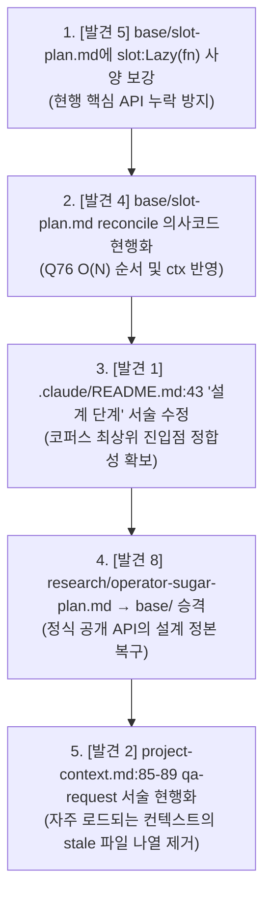

# quad 레포 `.claude/` 설계 문서 코퍼스 정리 탐사 보고서 (영역 B)

- **작성일**: 2026-10-15
- **탐사 환경**: git worktree `/code/Projects/quad-agy/docaudit-b` (`agy/docaudit-b`)
- **작업 원칙**: 읽기 전용 (레포 내 기존 코드 및 설계 문서 수정 0, 보고서만 작성)
- **탐사 대상**: `.claude/base/` 전 문서(34개), `.claude/reference/`, `.claude/feedback/`, `.claude/qa-request/README.md`, `.claude/audit/README.md`, `.claude/project-context.md`, 루트 `CLAUDE.md`, 각 폴더 `README.md` 색인
- **판정 기준**:
  - `python3 .claude/tools/doc-check.py`가 잡는 정적 오류(단순 깨진 링크·색인 누락)는 제외하고, **의미론적 불일치·낡은 서술·정정 배너 본문 미반영·문서 위치 오류**를 전수 대조.
  - 모든 주장에는 반드시 2개 이상의 파일:줄 근거(또는 실측 명령)를 제시.
  - 직접 실행 및 코퍼스 텍스트 직접 대조를 거친 것은 **[실측]**, 정황상 추론은 **[추정]**으로 표기.
  - 본 보고서의 모든 조치안은 **[제안]**이며, 최종 결정권은 사용자에게 있음.

---

## 1. 종합 요약

영역 B의 정본 설계 문서군(`.claude/base/` 34개 문서)과 프로젝트 거버넌스 문서(`.claude/README.md`, `project-context.md`, `CLAUDE.md`), 참고 자료(`reference/`, `feedback/`, `qa-request/README.md`, `audit/README.md`)를 전수 조사한 결과 총 **16건**의 의미론적 불일치 및 문서 배치 결함을 확인했습니다.

| 분류 | 건수 | 주요 내용 |
|---|---|---|
| **승격 / 이동 대상** | 4건 | 이미 구현 완료 및 결정 닫힌 `research/` 문서 4편 방치 (`Operator`, `bindable-hooks`, `upward-flow`, `public-surface`) |
| **정정 배너 본문 미반영** | 2건 | `slot-plan.md`의 O(N²) 재조정 의사코드 미수정, `bind-system-plan.md`의 모듈명 `D` 서술 미수정 |
| **누락된 신규 API 사양** | 1건 | 3.3.0에 추가된 `slot:Lazy(fn)` 사양의 `base/slot-plan.md` 누락 |
| **닫힌 문항 / 낡은 서술** | 7건 | M0~M11 구현 전 "구현 단계에서 결정/남은 것" 문장 방치, 이미 닫힌 `question.md` 용어 대기열 인용 잔존 등 |
| **갈라진 상태 서술 / 비대화** | 2건 | `gate-plan.md`의 형식적 열린 질문 헤더, `qa-request/README.md`의 옛 archive 라운드 3만 자 방치 |

---

## 2. 세부 발견 목록 (16건)

---

### [발견 1] `.claude/README.md`의 프로젝트 상태가 "구현 라운드 전(설계 단계)"으로 방치됨

- **종류**: 낡은 상태 서술
- **확신도**: **[실측]**
- **근거 1 (낡은 서술)**:
  - 파일: `.claude/README.md:42-44`
  - 인용:
    ```markdown
    `research/`의 문서가 설계 확정되면 `base/`로 승격(또는 구현 착수 시
    `qa-request/`행). 지금은 구현 라운드 전(설계 단계)이라 전부 `base/`/`research/`에만
    있음.
    ```
- **근거 2 (뒤집은 결정)**:
  - 파일: `.claude/project-context.md:13` 및 `CLAUDE.md:4` (2026-09-07)
  - 인용: `⭐ [2026-09-07 기준] v2 초기 구현 구간(M0~M11) 전부 완료 — 열린 마일스톤 없음.`
  - 파일: `.claude/qa-request/README.md:5` (구현 전 라운드 44개 전량 `archive/v2-initial-implementation/`로 이동 완료)
- **문제점**:
  - 프로젝트의 메인 진입 설명서인 `.claude/README.md`에서 현재 quad가 "구현 라운드 전(설계 단계)이라 전부 base/research에만 있음"이라고 기술하여, 저장소 상태를 읽는 새 에이전트나 사용자에게 프로젝트가 아직 코드 구현 전이라는 심각한 오판을 유발합니다.
- **제안하는 처리**:
  - `.claude/README.md` 43-44행의 `지금은 구현 라운드 전(설계 단계)이라 전부 base//research/에만 있음.` 문장을 삭제하거나, `현재는 v2 초기 구현 구간(M0~M11) 완료 및 3.x 안정화·실사용 피드백 수렴 단계임.`으로 갱신합니다.

---

### [발견 2] `.claude/project-context.md`에서 `qa-request/`의 상태를 옛 `pre-implementation-qa`로 서술함

- **종류**: 낡은 상태 서술
- **확신도**: **[실측]**
- **근거 1 (낡은 서술)**:
  - 파일: `.claude/project-context.md:85-89`
  - 인용:
    ```markdown
    - `.claude/qa-request/` — 원래는 "구현이 끝나고 사용자 실기기 QA만 남은 것"을
      담는 폴더였으나, **[2026-08-18]** 구현 전 사용자 심사 라운드의 산출물도
      여기 둠(`pre-implementation-qa-round1.md`/`pre-implementation-qa-round2.md`/
      `pre-implementation-qa-round3.md` 전부 **완료** — 라운드마다 새
      파일, 상태의 소스는 각 파일 자신).
    ```
- **근거 2 (뒤집은 결정)**:
  - 파일: `.claude/project-context.md:15-18` (2026-09-07)
  - 인용: `마일스톤별 규약·발견 원장(round1~21)과 옛 ROADMAP.md 본문...은 2026-09-07 사용자 결정으로 .claude/archive/v2-initial-implementation/에 이름 그대로 이동했다... 구현 뒤 코드 리뷰 원장은 .claude/qa-request/post-implementation-review-round1.md...`
  - 파일: `.claude/qa-request/README.md:5` (라운드 번호 1부터 새로 세며 `post-implementation-review-round*.md`로 전면 재편됨)
- **문제점**:
  - `project-context.md`의 55-78행에서는 `research/`, `luau-test/`, `audit/` 등의 세부 파일 목록 나열이 stale해지는 것을 방지하기 위해 각 폴더의 `README.md`로 책임을 위임해 두었습니다. 그러나 정작 85-89행의 `qa-request/` 항목에서는 이미 archive로 이전된 옛 2026-08-18 시점의 `pre-implementation-qa-round1~3.md`를 열거하고 있습니다. 실제 현재 `.claude/qa-request/` 폴더에는 `pre-implementation-*` 파일이 0개이며 전부 `post-implementation-review-round*.md`입니다.
- **제안하는 처리**:
  - `project-context.md:85-89`를 `qa-request/`의 현행 역할(구현 뒤 코드 리뷰 및 외부 감사 원장 `post-implementation-review-round*.md`)로 갱신하고, 다른 폴더들처럼 구체적 파일 나열은 `.claude/qa-request/README.md`를 참조하도록 단일화합니다.

---

### [발견 3] `.claude/base/architecture.md`에 M8(Slot) 구현 전 "남은 것" 메모 방치

- **종류**: 낡은 상태 서술
- **확신도**: **[실측]**
- **근거 1 (낡은 서술)**:
  - 파일: `.claude/base/architecture.md:375-376`
  - 인용:
    ```markdown
    **남은 것**: Slot 코어 로직의 정확한 API(`research`→`base` 승격된
    `slot-plan.md` 참고)와 각 파일의 정확한 함수/타입 이름은 구현 단계에서.
    ```
- **근거 2 (뒤집은 결정)**:
  - 파일: `.claude/base/architecture.md:311-319` (2026-09-07)
  - 인용: `quad-base/src/Slot/` 구조 정의 (`init.luau`, `types.luau`, `Single.luau`, `List.luau`, `Handler.luau`, `Reconcile.luau`, `Diff.luau`, `Key.luau` 8개 파일로 분할 구현 완료)
  - 파일: `CLAUDE.md:4` 및 `.claude/project-context.md:13` (M0~M11 전량 구현 완료)
- **문제점**:
  - M8 마일스톤 착수 전의 미결 서술인 "남은 것: Slot 코어 로직의 정확한 API와 각 파일의 정확한 함수/타입 이름은 구현 단계에서"가 구현 완료 후에도 삭제되지 않고 남아 있어 혼란을 줍니다.
- **제안하는 처리**:
  - `architecture.md:375-376`의 해당 2줄 문장을 완전히 삭제합니다.

---

### [발견 4] `base/slot-plan.md`의 `reconcile` 의사코드가 닫힌 문항 Q76(O(N) 정렬)을 반영하지 않고 옛 순서(O(N²))로 방치됨

- **종류**: 정정 배너 잔존 및 본문 미반영 (닫힌 문항)
- **확신도**: **[실측]**
- **근거 1 (낡은 서술 및 의사코드)**:
  - 파일: `.claude/base/slot-plan.md:1535-1538`
    ```markdown
    **[2026-09-27 round13 Q76·Q77 검토 중]** 아래 `reconcile`...이 O(n)이라는 전제와 무관하게,
    `Slot:List` 전체 교체가 O(N²)로 도는 경로(Q76)와 전체 역순에서 쓰지도 않는 offset 계산이 O(N²)를 만드는
    경로(Q77)가 성능 탐사에서 나왔다 — 프로토타입은 `audit/round13-q76-proto/`. 사용자 문항이 열려 있다
    (`qa-request/post-implementation-review-round13.md` §4). 본문은 결정 전이라 그대로 둔다.
    ```
  - 파일: `.claude/base/slot-plan.md:1744-1833`
    - 1744-1809행: 아이템 루프 (`for index, item in ipairs(data) do ... end`)
    - 1815-1832행: 소멸 루프 (`for key in pairs(prevKeys) do ... end`)
    - 1818행: `local result, ud = updateFn(KeyGone, 0, offset, prev, userdata[key])` (옛 5개 위치 인자)
- **근거 2 (뒤집은 결정)**:
  - 파일: `CHANGELOG.md:44-48` (2026-10-15 [Unreleased])
    ```markdown
    - **BREAKING — `slot:List` 재조정 한 사이클 안에서 `updateFn`이 불리는 순서를 더는 약속하지 않습니다**(항목끼리, 사라진 키의 `KeyGone`끼리, 항목과 사라진 키 사이 모두). 3.2.0은 "항목 먼저, 사라진 키 나중"을 적어 두었고, 이제는 사라진 키를 먼저 정리합니다 — 그래서 키를 전부 바꾸는 `:Set`(목록 통째 교체)이 원소 수의 제곱이 아니라 원소 수에 비례해 끝납니다(CLI mock에서 5000개 2.2초 → 0.1초).
    ```
  - 파일: `.claude/session-summary.md` 2026-10-15-01
    `round13 Q76 닫힘 — :List가 사라진 키를 먼저 정리(O(N)), updateFn 호출 순서는 정하지 않음(BREAKING, 사용자)`
  - 파일: `CHANGELOG.md:52-54` (`updateFn(ctx)` 단일 테이블 인자로 BREAKING 변경)
- **문제점**:
  - `slot-plan.md:1535-1538`에는 "본문은 결정 전이라 그대로 둔다"라는 배너가 여전히 걸려 있고, 본문 의사코드(1744-1833행)는 O(N²) 성능 병목의 원인이었던 "아이템 루프 먼저, 소멸 루프 나중" 순서 그대로 유지되어 있습니다. 게다가 `updateFn` 인자도 위치 인자 5개 형태로 남아 있어 현행 계약(`ctx` 단일 테이블)과 불일치합니다.
- **제안하는 처리**:
  - 1535-1538행 배너를 Q76 닫힘 및 BREAKING 반영 완료로 갱신합니다.
  - 1744-1833행 의사코드에서 소멸 루프(1815-1832행)를 아이템 루프(1744행) 앞으로 이동시키고, `updateFn` 호출 인자를 `ctx` 테이블 형태로 현행화합니다.

---

### [발견 5] `base/slot-plan.md`에 신규 추가된 핵심 공개 메서드 `slot:Lazy(fn)` 누락

- **종류**: 누락된 새 API (설계 정본 공백)
- **확신도**: **[실측]**
- **근거 1 (사양 누락)**:
  - 파일: `.claude/base/slot-plan.md` 전수 검색 시 `slot:Lazy` 또는 `Slot:Lazy` 메서드 정의/계약이 0건 (오직 'lazy 모델'이라는 형용사/부사 표현만 존재).
- **근거 2 (신설된 실물 및 결정)**:
  - 파일: `CHANGELOG.md:15-18` (2026-10-15 [Unreleased] Added)
    ```markdown
    - `slot:Lazy(fn)` — 빈 Slot에 **처음 꽂혀 마운트될 때 한 번만** 내용을 짓는 함수를 겁니다. `fn`이 돌려준 값 하나(원소·`State`·여러 원소를 담은 `Slot`, 또는 `nil`)가 내용이 되고, 뗐다 다시 꽂아도 다시 짓지 않습니다. 컴포넌트가 자기 본문에서 Context 등을 채운 **뒤에** 자식을 짓게 할 때 씁니다... 설치 규칙과 수동 CRUD 잠금은 `:List`/`:Single`과 같고... `fn`이 함수가 아니면 `Quad0271`, 값을 둘 이상 돌려주면 `Quad0272`.
    ```
  - 파일: `.claude/session-summary.md` 2026-10-15-01: `slot:Lazy(fn) 신설 — 사용자 착안: Context 등을 공급하는 컴포넌트가 Slot을 받아 꽂을 때...`
  - 파일: `.claude/audit/README.md:18` (`naming-defer-2026-10-15/`에서 `Lazy` 이름 확정)
- **문제점**:
  - `base/slot-plan.md`는 Slot 프리미티브의 정본 설계 문서인데, 2026-10-15 확정되어 릴리스에 포함된 신규 공개 표면 `slot:Lazy(fn)`의 계약(지연 1회 평가, Context 연계, CRUD 잠금, `Quad0271`/`Quad0272` 에러 계약 등)이 전혀 기술되어 있지 않습니다.
- **제안하는 처리**:
  - `base/slot-plan.md`의 `:Single`/`:List` 메서드 설명 섹션 뒤에 `slot:Lazy(fn)` 섹션을 신설하여 계약과 동작을 명문화합니다.

---

### [발견 6] `base/attribute-plan.md` 및 `base/tag-plan.md`에 이미 닫힌 "question.md 용어 정리 대기열" 서술 잔존

- **종류**: 닫힌 문항 / 낡은 상태 서술
- **확신도**: **[실측]**
- **근거 1 (낡은 서술)**:
  - 파일: `.claude/base/attribute-plan.md:737-741`
    ```markdown
    - **이름은 잠정 확정, 최종 확정은 대기열**: 겹침 방지를 위해 그룹 값은
      `Attr`, 단일 키는 `AttrKey`로 코드/문서 전체 통일해서
      당장의 해석 모호성은 없앴음 — 그래도 최종 이름은 다른 가칭들(`Slot`/
      `canExecute`/`Brand`)과 함께 `.claude/question.md` 용어정리
      대기열에 있음, 나중에 한꺼번에 재검토.
    ```
  - 파일: `.claude/base/tag-plan.md:355-356`
    ```markdown
    남은 건 이름 자체(`Tag`/`Added`/`Removed`/`Merged`)가 용어 정리
    대기열(`.claude/question.md` 1번)에 있다는 것뿐.
    ```
- **근거 2 (뒤집은 결정)**:
  - 파일: `.claude/question.md:119-122`
    ```markdown
    ## 1. 용어 정리 — 전부 해소됨(2026-09-15·16) — 원문은 archive
    **[2026-09-27 정리 — round13 E74]** 이 절의 항목 일곱(`Slot`·`Owned`/`OwnsElements`·`canExecute`·`hintValue`/`nextValue`·`Brand`·`Tag`/`Added`/`Removed`/`Merged`·`Attr`/`AttrKey`)은 2026-09-15·16에 전부 해소됐는데... 원문은 이 문서 규약대로 `archive/question-resolved.md`의 "용어 정리 절 전체" 절로 옮겼다 — 여기 남은 열린 용어 항목은 없다.
    ```
- **문제점**:
  - `question.md` 1번 "용어 정리" 절은 2026-09-15·16에 전량 확정 및 해소되어 `archive/question-resolved.md`로 완전히 이관되었습니다. 그럼에도 불구하고 `attribute-plan.md`와 `tag-plan.md` 본문에는 여전히 해당 이름들이 "question.md 용어 정리 대기열에 있다"고 적혀 있어 열린 질문으로 오해를 줍니다.
- **제안하는 처리**:
  - `attribute-plan.md:737-741`과 `tag-plan.md:355-356`의 "용어 정리 대기열에 있음" 문장을 "2026-09-15·16 확정 완료(원문 archive/question-resolved.md)"로 갱신합니다.

---

### [발견 7] base/source-state-plan.md의 "정확한 함수·생성자 이름 미정" 서술 잔존

- **종류**: 닫힌 문항 / 낡은 상태 서술
- **확신도**: **[실측]**
- **근거 1 (낡은 서술)**:
  - 파일: `.claude/base/source-state-plan.md:1988-1990`
    ```markdown
    - **`state()`/`Source()`/`Get()` 등 정확한 함수·생성자 이름** — 방향은
      전부 확정, 이름만 구현 단계에서 남음. `State`/`Source`/`Compute` 자체는
      이미 최종 확정(위 "이름 주의"/"네이밍 — `Compute`가 `-ed`가 아닌 이유").
    ```
- **근거 2 (뒤집은 결정)**:
  - 파일: `base/architecture.md:297-298` (Source.luau, State.luau 확정 구현)
  - 파일: `project-context.md:13` (M0~M11 전량 구현 완료)
  - 파일: `quad-base/src/Source.luau:1` (실제 `Source(initial)` 함수 및 `:Get()` 실장)
- **문제점**:
  - M2 마일스톤 구현 단계에서 이미 `Source` 생성자, `State` 모듈, `:Get()` 메서드 이름이 확정 및 구현 완료되었음에도, 1988행의 "이름만 구현 단계에서 남음" 서술이 삭제되지 않았습니다.
- **제안하는 처리**:
  - `source-state-plan.md:1988-1990`의 문장을 구현 완료로 갱신하거나 해당 불릿을 삭제합니다.

---

### [발견 8] `base/operator-plan.md`가 구현 완료 후에도 `research/`에 방치됨

- **종류**: 승격 / 이동 대상 문서
- **확신도**: **[실측]**
- **근거 1 (현재 위치 및 문서 머리)**:
  - 파일: `.claude/base/operator-plan.md:3, 15`
  - 인용:
    ```markdown
    > **⭐ [2026-09-08 구현 — 사용자 범위 확정]** `quad-base/src/Operator.luau`(의존 없는 잎, `quad.Operator.*`), 스펙 `spec.operator`.
    ...
    **상태**: ~~research~~ **[2026-09-08 구현 완료 — 위 배너가 소스; 아래 이 문단은 착수 전 서술]**
    ```
- **근거 2 (폴더 규약 및 아키텍처 정본)**:
  - 파일: `.claude/README.md:27-29` (`research/`는 아직 착수 전이거나 사용자 상의가 필요한 설계 논의를 두는 곳이며, 확정된 것은 `base/`로 승격)
  - 파일: `base/architecture.md:346` (`Operator.luau` 2026-09-08 구현 완료, 공개 표면)
  - 파일: `base/docs-handover-registry.md:139` ("순수 슈거 그룹(2026-09-08 구현) ... q.Operator.* 열넷")
- **문제점**:
  - `Operator.luau`는 2026-09-08에 구현 완료되어 quad의 정식 공개 표면(14개 오퍼레이터 함수)으로 제공되고 있습니다. 그러나 설계 문서가 여전히 `research/`에 방치되어 있어 `base/README.md` 색인에도 없고, 설계 정본이 아닌 리서치 단계로 오인됩니다.
- **제안하는 처리**:
  - `base/operator-plan.md`를 (제안 경로) base/operator-plan.md로 승격하고, `base/README.md` 및 `.claude/README.md` 색인에 반영합니다.

---

### [발견 9] `backlog/bindable-brand-publication.md`가 내부 정리 결정 완료 후에도 `research/`에 방치됨

- **종류**: 승격 / 이동 대상 문서
- **확신도**: **[실측]**
- **근거 1 (현재 위치 및 문서 머리)**:
  - 파일: `.claude/backlog/bindable-brand-publication.md:3, 5`
  - 인용:
    ```markdown
    **상태**: research — 사용자 요청(2026-09-28 세션)으로 신설. **[2026-10-01 결정 — 내부 정리만 지금(2절 표 (A)~(F)가 전부 코드에서 빠졌다... 동작 변경 0)... 서드파티 확장은 서드파티 수요가 생길 때 — 백로그.**
    ```
- **근거 2 (폴더 규약 및 아키텍처 정본)**:
  - 파일: `base/architecture.md:343` (2026-10-01 내부 정리 사용자 결정 완료: 값 타입도 모른다, 훅 본문은 Observer.luau/Effect.luau가 각자 가짐)
  - 파일: `.claude/reference/README.md:5` ("확정된 결정의 '왜 그렇게 정했나' 근거 기록도 여기(reference/) 둔다")
- **문제점**:
  - 2026-10-01에 사용자 결정으로 내부 정리가 완료되었고 서드파티 확장은 백로그로 정리되었습니다. 이 문서는 현재 아키텍처 내부 정리의 근거 기록이므로 `research/`에 남을 이유가 없으며 `reference/` 규약에 부합합니다.
- **제안하는 처리**:
  - `backlog/bindable-brand-publication.md`를 `.claude/reference/bindable-hooks-composition.md`로 이동하고 `reference/README.md` 색인에 편입합니다.

---

### [발견 10] `archive/surveys/2026-09-21-upward-flow-plan.md`가 결정 및 구현(`q.Out`) 완료 후에도 `research/`에 방치됨

- **종류**: 승격 / 이동 대상 문서
- **확신도**: **[실측]**
- **근거 1 (현재 위치 및 문서 머리)**:
  - 파일: `.claude/archive/surveys/2026-09-21-upward-flow-plan.md:3`
  - 인용:
    ```markdown
    **상태**: ~~research — 착수 안 함, 사용자 결정 대기~~ **[2026-09-21 밤 닫힘 — 7절 문항 다섯 전부 결정(각 항목 "닫힘" 마커), 되쓰기 슈거 `q.Out(name, src)` 구현·커밋(`quad-roblox/src/Handlers/OnChange.luau`, 문서 GS 06·roblox/05)]**. 이 파일이 `research/`에 남은 것은 8절 논거 원문을 `base/onchange-plan.md`로 옮기는 일이 백로그라서다(`question.md` 2절은 이제 이 문서를 가리키지 않음).
    ```
- **근거 2 (실제 코드 및 릴리스)**:
  - 파일: `CHANGELOG.md:20` (`q.Out(name, src)` 정식 구현)
  - 파일: `.claude/session-summary.md` 2026-09-21-03 밤 결정
- **문제점**:
  - 문서 머리 스스로 적고 있듯이 문항 5개가 전부 닫히고 `q.Out` 구현까지 끝났음에도, "8절 논거를 옮기는 일이 백로그"라는 이유로 `research/`에 방치되어 있습니다.
- **제안하는 처리**:
  - 8절 논거 원문을 `base/onchange-plan.md`에 흡수한 뒤, 본 문서를 `reference/` 또는 `archive/`로 이동합니다.

---

### [발견 11] `research/public-surface-pre-adoption-review.md`가 전 문항 닫힘 후에도 `research/`에 방치됨

- **종류**: 승격 / 이동 대상 문서
- **확신도**: **[실측]**
- **근거 1 (문서 상태)**:
  - 파일: `.claude/research/public-surface-pre-adoption-review.md:17-33`
  - 인용: 16개 문항 전부에 `[닫힘 2026-09-14]` 또는 `[닫힘 2026-09-15]` 마커가 붙어 있음 (`Declaration` 개명, 버전 패턴, lockstep 분리 등).
- **근거 2 (실제 코드 반영 및 규약)**:
  - 파일: `CHANGELOG.md:4, 30, 40` (3.2.0 변경사항으로 코드에 전량 반영 완료)
  - 파일: `.claude/reference/README.md:5` ("확정된 결정의 근거 기록은 reference/에 둔다")
- **문제점**:
  - 3.2.0 공개 표면 개편을 위해 검토되었던 16개 문항이 전부 닫히고 코드베이스에 반영 완료되었습니다. 현재 유효한 여러 결정(예: `Declaration` 개명 배경, lockstep 탈피 등)의 근거 자료 역할을 하고 있으므로 `research/`가 아니라 `reference/`에 위치해야 합니다.
- **제안하는 처리**:
  - 본 문서를 `.claude/reference/public-surface-review-2026-09-13.md`로 이동하고 `reference/README.md` 색인에 등록합니다.

---

### [발견 12] `base/bind-system-plan.md:539-541`에서 모듈 이름을 `D`로 확정했다고 기술하여 본문 앞의 `Declaration` 개명 배너와 모순됨

- **종류**: 정정 배너 잔존 및 본문 미반영 (문서 내 상태 서술 갈라짐)
- **확신도**: **[실측]**
- **근거 1 (오래된 본문 서술)**:
  - 파일: `.claude/base/bind-system-plan.md:539-541`
  - 인용:
    ```markdown
    - **[해소, 2026-08-18] 모듈 이름은 `D`로 확정** — 옛 항목("`DI`(또는 다른
      이름) 등 정확한 모듈 이름")은 닫혔다. 근거는 위 "인스턴스 생성 / 이벤트
      네이밍 인체공학" 절. Source/State 쪽 이름 문제는
      `base/source-state-plan.md`가 소스.
    ```
- **근거 2 (앞선 정정 배너 및 CHANGELOG)**:
  - 파일: `.claude/base/bind-system-plan.md:150-152`
    ```markdown
    **[2026-09-14 정정 — 사용자 결정]** 위 2026-08-18 확정은 **원문 그대로 남기되 더 이상 현행이
    아니다** — 모듈 필드·타입 이름은 이제 `Declaration`이다(`q.Declaration`, `export type
    Declaration`/`DeclarationMapper`/`DeclarationModifier`...)
    ```
  - 파일: `CHANGELOG.md:4` (3.2.0 `Declaration` 개명 반영)
- **문제점**:
  - 150행에는 2026-09-14 정정 배너를 달아 "모듈 필드·타입 이름은 이제 `Declaration`이다"라고 선언했으나, 539행의 "남은 열린 질문" 해소 목록에서는 정정 배너 없이 "[해소, 2026-08-18] 모듈 이름은 `D`로 확정"이라고 서술되어 있어 한 문서 내에서 상태 서술이 모순을 일으킵니다.
- **제안하는 처리**:
  - 539행의 문장을 `- **[해소, 2026-08-18 / 2026-09-14 개명] 모듈 이름은 Declaration으로 확정(D는 별칭)**`으로 수정합니다.

---

### [발견 13] `base/gate-plan.md:82`의 절 제목에 "(사용자 판단 필요)"가 남아있어 머리 배너와 모순됨

- **종류**: 갈라진 상태 서술 (형식적 열린 질문 헤더 잔존)
- **확신도**: **[실측]**
- **근거 1 (절 제목)**:
  - 파일: `.claude/base/gate-plan.md:82`
  - 인용: `## 아직 안 정한 것 (사용자 판단 필요)`
- **근거 2 (머리 배너 및 하위 항목 전수 해소)**:
  - 파일: `.claude/base/gate-plan.md:9-10`
    `남은 것은 아래 "아직 안 정한 것"의 생명주기와 마일스톤 범위뿐이고, 둘 다 구현 시 정하면 되는 것들이다 — 사용자 판단이 필요한 항목은 없다`
  - 파일: `.claude/base/gate-plan.md:84, 90, 170, 178` (82행 하위 항목 1, 2, 3, 4번 모두 `[2026-08-21 해소/확정]` 완료)
- **문제점**:
  - 문서 머리(9-10행)에서 "사용자 판단이 필요한 항목은 없다"고 선언했고 하위 4개 항목이 전량 해소되었음에도, 82행의 제목이 여전히 `## 아직 안 정한 것 (사용자 판단 필요)`로 남아 있어 독자에게 미결 항목이 있는 것으로 오해를 줍니다.
- **제안하는 처리**:
  - 82행 제목을 `## 열린 질문이었던 것 — 전부 해소됨 (2026-08-21)`으로 변경합니다.

---

### [발견 14] `base/architecture.md:857-858`에 2026-08-04 시점 옛 서술 잔존

- **종류**: 낡은 상태 서술
- **확신도**: **[실측]**
- **근거 1 (낡은 서술)**:
  - 파일: `.claude/base/architecture.md:857-858`
  - 인용:
    ```markdown
    정식 확정됨 — **더 이상 열린 질문 아님**, [2026-08-04 기준] 남은 건 정확한
    API 이름뿐.
    ```
- **근거 2 (뒤집은 결정)**:
  - 파일: `.claude/base/architecture.md:297-300` (Source.luau, Store.luau API 확정)
  - 파일: `CLAUDE.md:4` 및 `.claude/project-context.md:13` (M0~M11 전량 구현 완료)
- **문제점**:
  - `store.key`의 dot-access 설계 확정을 설명하면서 "2026-08-04 기준 남은 건 정확한 API 이름뿐"이라는 구현 착수 전의 서술이 그대로 남아 있습니다.
- **제안하는 처리**:
  - 857-858행의 `[2026-08-04 기준] 남은 건 정확한 API 이름뿐.` 문장을 삭제하거나 M2/M4 구현 완료 반영으로 정리합니다.

---

### [발견 15] `base/component-composition-plan.md:6`에 2026-08-04 시점 옛 서술 잔존

- **종류**: 낡은 상태 서술
- **확신도**: **[실측]**
- **근거 1 (낡은 서술)**:
  - 파일: `.claude/base/component-composition-plan.md:6`
  - 인용:
    ```markdown
    [2026-08-04 기준] 남은 건 API 이름뿐(아래 "남은 열린 질문" 참고). `base/bind-system-plan.md`의
    ```
- **근거 2 (뒤집은 결정)**:
  - 파일: `.claude/base/component-composition-plan.md:346-347` (2026-09-06 round21 Q3: 별도 `Component` 래퍼는 만들지 않기로 확정, M9 구현 완료)
  - 파일: `.claude/project-context.md:13` (M0~M11 구현 완료)
- **문제점**:
  - 문서 머리에서 "[2026-08-04 기준] 남은 건 API 이름뿐"이라고 적고 있으나, 문서 후반(346행)에서는 2026-09-06에 이름 문항이 어떻게 종결되었는지(`Component` 래퍼 미제작, 플레인 함수 관례 유지)를 이미 다루고 있어 머리 요약이 뒤처져 있습니다.
- **제안하는 처리**:
  - 6행의 `[2026-08-04 기준] 남은 건 API 이름뿐(아래 "남은 열린 질문" 참고).` 문장을 삭제하거나 2026-09-06 확정 반영으로 정리합니다.

---

### [발견 16] `.claude/qa-request/README.md:5`에 archive로 이전된 옛 44개 라운드 설명(32,471자)이 한 셀에 방치됨

- **종류**: 갈라진 상태 서술 및 단일 소스 원칙 위배 (문서 비대화)
- **확신도**: **[실측]**
- **근거 1 (비대해진 단락)**:
  - 파일: `.claude/qa-request/README.md:5` (총 길이 32,471 bytes)
  - 인용: 5행의 긴 단락 안에 2026-09-07에 `archive/v2-initial-implementation/`로 이전된 옛 `pre-implementation-qa-round1.md`부터 `pre-implementation-handtrace-round10*`까지의 라운드 설명 수만 자가 인라인으로 압축되어 방치됨.
- **근거 2 (README 분리 목적 및 archive 이동 결정)**:
  - 파일: `.claude/qa-request/README.md:3`
    `루트 .claude/README.md가 폴더마다 수천~수만 자의 행을 쥐고 있어(한 셀 17,005자) 폴더별 README.md로 나눴다`
  - 파일: `.claude/project-context.md:15` (2026-09-07 사용자 결정으로 v2 초기 구현 구간 44개 문서는 archive로 이동)
- **문제점**:
  - 3행에서 "루트 README가 한 셀에 17,005자를 쥐고 있어 폴더별 README로 나눴다"고 명시해 놓고, 정작 `qa-request/README.md:5`의 한 셀에 32,471자나 되는 옛 archive 라운드 히스토리를 채워 넣었습니다. 현재 `qa-request/`에는 `post-implementation-review-round1~14.md`만 존재하므로, 폴더 색인으로서의 가독성과 탐색 효율을 심각하게 저해하고 있습니다.
- **제안하는 처리**:
  - 5행의 archive 이전 라운드 44개에 대한 긴 세부 인라인 설명을 대폭 압축하여 `archive/v2-initial-implementation/` 링크 한 줄로 갈음하고, 현재 실제 폴더에 존재하는 `post-implementation-review-round1~14.md`의 색인 표를 가독성 높은 마크다운 테이블로 재정리합니다.

---

## 3. 가장 먼저 손볼 다섯 (우선순위 제안)

코퍼스의 정합성과 개발자/에이전트의 작업 혼란 방지 관점에서 가장 파급력이 큰 다섯 항목을 선정했습니다.



### 1) [발견 5] `base/slot-plan.md`에 `slot:Lazy(fn)` 사양 명문화
- **이유**: `slot:Lazy(fn)`는 3.3.0에 추가된 최신 공개 API로, 이미 실물 코드와 CHANGELOG, audit 기록에 반영되어 활발히 사용되고 있습니다. 그러나 슬롯의 정본 설계 문서인 `slot-plan.md`에 이 메서드의 존재 자체가 빠져 있어 설계와 코드의 공백이 큽니다.
- **조치 제안**: `base/slot-plan.md`에 `:Lazy(fn)`의 평가 시점(최초 마운트 1회), Context 공급 컴포넌트와의 조합 원칙, CRUD 잠금 및 에러 계약(`Quad0271`, `Quad0272`)을 추가.

### 2) [발견 4] `base/slot-plan.md`의 O(N²) 재조정 의사코드 및 배너 현행화
- **이유**: Q76은 전체 교체 시 O(N²) 병목을 O(N)으로 해결하고 호출 순서 보장을 없앤 중대한 BREAKING 변경입니다. `slot-plan.md:1535`에 "결정 전이라 본문 그대로 둔다"는 배너와 함께 O(N²) 순서의 의사코드가 그대로 남아 있으면, 슬롯 재조정 알고리즘을 참조하는 에이전트가 잘못된 구현이나 검증 코드를 작성하게 됩니다.
- **조치 제안**: 1535행 배너를 "Q76 닫힘"으로 갱신하고, 의사코드의 소멸 루프를 아이템 루프 앞으로 재배치하며 인자 모양을 `ctx` 테이블로 일치시킴.

### 3) [발견 1] `.claude/README.md:43`의 "구현 라운드 전(설계 단계)" 서술 수정
- **이유**: 저장소 설계 코퍼스의 최상위 진입 문서에서 프로젝트가 아직 코드 구현 전이라고 서술하는 것은, 코퍼스를 처음 읽는 모든 서브에이전트와 외부 모델에게 가장 치명적인 컨텍스트 왜곡을 일으킵니다.
- **조치 제안**: 해당 문장을 삭제하거나 현재 구현 완료 및 안정화/소비자 킷 단계로 갱신.

### 4) [발견 8] `base/operator-plan.md`를 (제안 경로) base/operator-plan.md로 승격
- **이유**: `q.Operator.*`는 2026-09-08에 이미 구현 완료되어 `quad-base`의 공개 표면이자 `docs/`의 정식 슈거로 제공되고 있습니다. 구현이 끝나 안정화된 설계 문서가 `research/`에 계속 방치되어 있어 `base/`만 읽는 에이전트가 오퍼레이터 설계를 놓치게 됩니다.
- **조치 제안**: 문서를 (제안 경로) base/operator-plan.md로 이동하고 `base/README.md` 색인에 편입.

### 5) [발견 2] `project-context.md:85-89`의 `qa-request/` 서술 현행화
- **이유**: `project-context.md`는 루트 `CLAUDE.md`가 `@import`하여 매 세션마다 모든 에이전트의 컨텍스트로 주입되는 핵심 문서입니다. 이미 archive로 넘어간 옛 `pre-implementation-qa-round1~3`을 현재 폴더 내용인 것처럼 가리키는 오류를 제거해야 합니다.
- **조치 제안**: `post-implementation-review-round*.md` 체계로 설명을 교체하고 구체적 파일 나열은 `qa-request/README.md`로 일임.

---

## 4. 미완 및 한계

- **외부 문서(`docs/`) 및 구현 코드와의 1:1 대조**:
  - 본 탐사는 영역 B의 설계 코퍼스(`.claude/base/`, `reference/`, `feedback/`, 폴더별 README, 프로젝트 관리 문서) 내부의 정합성 대조에 집중했습니다.
  - 사용자 문서 `docs/` 전편이나 실제 Luau 구현 코드와의 미세 시그니처 1:1 일치 여부는 별도 영역의 감사 대상이므로 본 보고서의 범위에서 제외했습니다.
