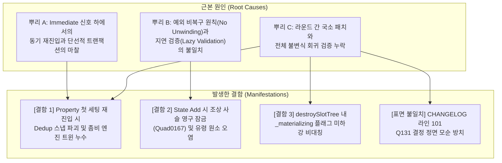

> 보관본 — worktree 경로의 프로브 인용은 이 폴더의 `probes/` 이름으로 바꿨다(그 worktree는 지움). 판정은 같은 폴더 README.

# quad 코어 3.2.0 이후 변경 종합 검토 보고서: 라운드 간 상호작용 및 공개 표면 수렴 분석

- **작업 환경**: `/code/Projects/quad-agy/review-core-320` (branch: `agy/review-core-320`)
- **검토 기준점**: 태그 `3.2.0` (커밋 `cce69b2`)부터 `HEAD` (커밋 `f38e05cb`)까지의 약 120 커밋, ~5,000줄 추가분
- **테스트 기준 검증**: `./scripts/test.sh` 실행 (Exit code: 0, ALL PASS)
- **보고서 작성일**: 2026-10-15

---

## 1. 개요 및 검토 방법론

본 검토는 quad 코어의 `3.2.0` 릴리즈 이후 round 11부터 round 14까지 약 한 달간(2026-09-15 ~ 2026-10-13) 누적된 변경 사항을 대상으로 합니다. 각 리뷰 라운드는 개별적인 이슈 범위에 집중했기 때문에, 서로 다른 라운드에서 도입되거나 철거된 방어 기제들이 만나는 접점(Cross-Round Interaction)에서 발생하는 결함을 중점적으로 감사했습니다.

검토의 핵심 원칙:
1. **라운드 간 상호작용 결함 발굴**: 단일 커밋의 국소 버그가 아니라, 두 라운드 이상의 변경이 결합되었을 때만 발생하는 재진입, 가드 플래그, 엔진 시그널(Immediate/Deferred), GC 및 에러 후 상태 이상을 추적.
2. **실행 가능한 재현(실측/추정 명시)**: 모든 주장은 worktree 내 테스트 하네스를 통해 실제 실행 가능한 프로브(`.luau`) 스크립트와 출력 결과(실측)로 입증하며, 코드 분석에 기반한 내용은 추정으로 명확히 구분.
3. **공개 표면 수렴성 판정**: `CHANGELOG.md`의 `[Unreleased]` BREAKING 31줄 전수 조사, 코드/결정 원장 간의 일치 여부 대조, 향후 또다시 BREAKING 변경이 발생할 구조적 취약점 제시.
4. **사용자 결정권 존중**: 모든 개선책은 "결정"이 아닌 "제안"으로 명시.

---

## 2. 두 라운드 이상의 변경이 결합되어 발생하는 결함

---

### [결함 1] PropertyHandler 첫 세팅 경로의 Immediate 재진입 시 Dedup 스냅 파괴 및 영구 좀비 엔진 트윈 누수

- **판정**: **실측**
- **심각도**: **High**
- **관련 파일**: [`quad-roblox/src/Handlers/Property.luau`](file:///code/Projects/quad-agy/review-core-320/quad-roblox/src/Handlers/Property.luau#L66-L75), [`quad-roblox/src/Handlers/Property.luau`](file:///code/Projects/quad-agy/review-core-320/quad-roblox/src/Handlers/Property.luau#L325-L336)
- **관련 커밋**:
  - `e955cbde` (round14 Q184 (a), 2026-10-12): "쓰기가 동기로 일으킨 신호가 같은 자리에 다시 들어오면 바깥 처리가 물러난다(안쪽 기록이 남는다)"
  - `1e3e4680` (round10 Q53 (a) / round11 Q65, 2026-09-18): 슬롯 기록을 인스턴스 수명 동안 보존하여 첫 세팅 스냅과 dedup 유지
  - round3 Q26 (a) (2026-09-08): 첫 스냅은 `{ Value }`를 기록하여 같은 목표 재발행 시 엔진 트윈 0회 보장

#### 무엇이 틀렸는가 (평문 설명)
Roblox의 `SignalBehavior`가 `Immediate`인 환경(또는 동기 이벤트 환경)에서 인스턴스의 특정 프로퍼티에 **처음으로 값을 쓸 때 (`prev == nil`)**, `inst[k] = v` 실행 즉시 엔진의 `Changed` 신호나 `q.OnChange` 콜백이 동기적으로 발화합니다.
만약 이 콜백 내부에서 같은 프로퍼티에 다른 값(예: `Tween(99)`)을 다시 쓰는 재진입(Re-entry)이 일어나면, 안쪽 처리가 정상적으로 자신의 엔진 트윈이나 스냅 레코드(`{ Tween = ..., Value = 99 }`)를 `tweenSlots`에 저장합니다.
그러나 안쪽 처리가 끝난 뒤 제어권이 바깥쪽 첫 세팅 처리로 돌아오면, 바깥쪽 처리는 `tweenSlots`가 안쪽 처리에 의해 이미 변경되었는지 검사하지 않고 무조건 `tweenSlots:SetStrong(inst, k, true)`(또는 스냅의 경우 `{ Value = v.Value }`)를 덮어써 버립니다.

이로 인해 두 가지 치명적인 결함이 발생합니다:
1. **영구 좀비 엔진 트윈(Orphaned Engine Tween) 누수**: 안쪽 처리가 엔진 트윈을 재생하기 시작했더라도 바깥쪽이 `tweenSlots`를 `true`로 덮어써 버리므로, Quad는 진행 중인 엔진 트윈의 참조를 영구적으로 잃어버립니다. 이후 `q.Dispatch.retractFrom`으로 자리를 철거하거나 plain 값을 대입해도 해당 엔진 트윈은 **영원히 Cancel되지 않고 백그라운드에서 계속 실행**됩니다.
2. **Dedup 레코드 영구 오염**: 안쪽 처리가 스냅(`snap()`)을 수행했더라도 바깥쪽이 자신의 값으로 레코드를 덮어써 인스턴스의 실제 프로퍼티 값(`50`)과 Quad의 슬롯 기록(`10`)이 불일치하게 됩니다. 이후 동일한 값 `10`의 트윈을 재선언하면 Dedup이 잘못 적용되어 트윈이 전혀 실행되지 않고, 실제 값인 `50`을 선언하면 불필요한 엔진 트윈이 재생됩니다.

#### 발생 원인 (설계 결함의 뿌리)
커밋 `e955cbde` (Q184)는 `prev ~= nil`인 세 가지 분기(plain 값 쓰기, zero-time 스냅, Finish 스냅)에 대해서는 `if tweenSlots:GetStrong(inst, k) ~= prev then return end` 검사를 추가하여 안쪽 처리가 발생했을 때 바깥쪽이 물러나도록 올바르게 처리했습니다.
하지만 `prev == nil`인 첫 세팅 분기(라인 325~336)에서는 다음 주석과 함께 이 검사를 완전히 누락했습니다:
> *"The FIRST set of a slot needs no re-check: it runs inside the State handler's Observer install, where a re-entrant emit is held, not delivered (mutants of a re-check there survived the spec)."* ([`Property.luau:66-70`](file:///code/Projects/quad-agy/review-core-320/quad-roblox/src/Handlers/Property.luau#L66-L70))

이 주석의 전제는 완전히 틀렸습니다. 프로퍼티의 첫 세팅은 `StateHandler`의 `Observer` 설치 내부에서만 일어나는 것이 아닙니다. 일반적인 plain 값의 첫 세팅(`q.Dispatch.process(inst, k, v, 1)` 또는 `Declaration.Frame { Prop = plainValue }`에서 이벤트를 구독 중인 인스턴스)에서도 `prev == nil` 분기를 타며, 엔진의 동기 시그널은 즉시 재진입을 일으킬 수 있습니다. 또한 `spec.tweenproperty.luau`의 Q184 테스트 케이스(`scene("plain from plain", nil, 3, 3, "S99")`)는 `Frame` 생성 시 이미 `Size = 0`이 쓰여 `prev`가 `true`인 상태에서 `src:Set(3)`을 호출했기 때문에 `prev == nil` 경로를 전혀 검증하지 못했습니다.

#### 재현 프로브 1: 좀비 엔진 트윈 누수
- **프로브 파일**: probes/tmp.probe_orphan_tween.luau
- **실행 명령**:
  ```bash
  ( ulimit -v 4000000; timeout 600 mise exec -- luau quad-roblox/test/tmp.probe_orphan_tween.luau )
  ```
- **실측 출력 결과**:
  ```
  Playing tweens after outer return:	99
  --- Calling q.Dispatch.retractFrom(inst, Position, 1) ---
  Playing tweens after retractFrom:	99
  --- Calling q.Dispatch.process(inst, Position, 0, 1) ---
  Playing tweens after process plain 0:	99
  ```
- **결과 설명**: 첫 세팅 시점의 동기 재진입으로 생성된 엔진 트윈 `99`가 바깥쪽 처리에 의해 레코드가 덮어써진 결과, 이후 `retractFrom`(철거)을 호출하거나 plain 값 `0`을 대입하여 트윈을 종료하려 해도 취소되지 않고 **영구히 재생 중(Playing)**인 상태로 잔류함을 실측으로 확인했습니다.

#### 재현 프로브 2: Dedup 레코드 역전 오염
- **프로브 파일**: probes/tmp.probe_first_snap_dedup.luau
- **실행 명령**:
  ```bash
  ( ulimit -v 4000000; timeout 600 mise exec -- luau quad-roblox/test/tmp.probe_first_snap_dedup.luau )
  ```
- **실측 출력 결과**:
  ```
  inst.Position =	50
  Did it think 10 was already set (Dedup)? engine tweens count change =	0
  Did it think 50 was already set? engine tweens count change =	1
  ```
- **결과 설명**: 인스턴스의 실제 값은 재진입에 의해 `50`이 되었으나 바깥쪽 처리가 `{ Value = 10 }`으로 덮어써, 이후 동일한 값인 `10`의 트윈을 선언했을 때는 엔진 트윈이 재생되지 않고(잘못된 Dedup), 실제 인스턴스 값인 `50`의 트윈을 선언했을 때 불필요한 트윈이 새로 생성(엔진 트윈 수 1 증가)됨을 실측으로 확인했습니다.

---

### [결함 2] State 지연 검증(`H-517` 철거)과 조상 가드 사슬(`raiseChain`) 충돌로 인한 슬롯 원소 오염 및 전체 조상 트리 영구 잠금

- **판정**: **실측**
- **심각도**: **High**
- **관련 파일**: [`quad-base/src/Slot/init.luau`](file:///code/Projects/quad-agy/review-core-320/quad-base/src/Slot/init.luau#L210-L213), [`quad-base/src/Slot/init.luau`](file:///code/Projects/quad-agy/review-core-320/quad-base/src/Slot/init.luau#L245-L254), [`quad-base/src/Slot/Raw.luau`](file:///code/Projects/quad-agy/review-core-320/quad-base/src/Slot/Raw.luau#L112-L127), [`quad-base/src/Slot/Raw.luau`](file:///code/Projects/quad-agy/review-core-320/quad-base/src/Slot/Raw.luau#L163-L166), [`quad-base/src/Slot/Elements.luau`](file:///code/Projects/quad-agy/review-core-320/quad-base/src/Slot/Elements.luau#L33-L55)
- **관련 커밋**:
  - `d974dfcb` (round14 Q170, 2026-10-06): "`H-517` 철거 — State 원소의 사전 검사(`:Get()`) 철거, lazy 모델(마운트/재조정 시점 검사)로 전환"
  - `06140417` (round13 Q74 (a), 2026-10-01): `raiseChain` 도입 — `_materializing = true` 플래그를 조상 사슬 전체로 전파
  - `f38e05cb` (round14 Q186 (a), 2026-10-13): `raiseChain`을 `rawAdd`/`rawReplace`/`rawSplice`의 `attachSlot` 및 백엔드 호출 구간에 적용
  - Quad 아키텍처 원칙: "사용자 예외는 pcall로 감싸 복구하지 않으며(No unwinding), 예외 발생 시 해당 트리는 불능 상태로 둔다"

#### 무엇이 틀렸는가 (평문 설명)
이미 마운트되어 실행 중인 UI 트리에서 자식 슬롯에 잘못된 원소(예: 유효하지 않은 값 `123`, 미등록 인스턴스, 또는 잘못된 객체)를 담은 `State`를 `childSlot:Add(badState)` 또는 `childSlot:Replace(i, badState)`로 추가할 때:
1. 평범한 값(`childSlot:Add(123)`)을 넘겼다면 `prepareElements`의 사전 검증에서 `Quad0240`을 던지며 **슬롯의 어떠한 내부 상태도 변경되지 않고 깨끗하게 거절**됩니다.
2. 그러나 `State`(`q.Source(123)`)를 넘기면, round14 Q170에서 `H-517`을 철거했기 때문에 `prepareElements`는 값을 검사하지 않고 래퍼 슬롯으로 감싼 뒤 `rawAdd`로 넘깁니다.
3. `rawAdd`는 이미 마운트된 슬롯이므로:
   - `self._elements`에 래퍼 슬롯을 이미 삽입합니다.
   - `raiseChain(self)`를 호출하여 **자신뿐 아니라 부모, 조부모, 루트 슬롯까지 포함한 전체 소유권 조상 사슬의 `_materializing = true` 플래그를 올립니다.**
   - `S.attachSlot`을 호출하여 래퍼 슬롯의 `:Single`을 활성화합니다.
4. `:Single` 활성화 과정에서 `badState:Get()`의 값 `123`이 읽히고 유효성 검사 에러(`Quad0240`)가 발생하여 Luau 호출 스택이 언와인딩됩니다.
5. 이로 인해 `restoreChain`이 호출되지 못해 **루트 슬롯을 포함한 전체 조상 사슬의 `_materializing = true` 플래그가 영구히 내려오지 않고 고착**됩니다.
6. 또한 `childSlot._elements`에는 미완성된 유령 래퍼 슬롯이 이미 등록되어 부기가 영구적으로 깨집니다.
7. 그 결과, 자식 슬롯의 단순한 인자 오류 하나로 인해 **최상위 루트 슬롯을 포함한 전체 UI 트리에 대한 모든 후속 CRUD(`Add`, `Remove`, `Move` 등)가 영구히 `Quad0167` 에러로 차단되어 UI 트리 전체가 영구 불능(Bricked)**에 빠집니다.

#### 발생 원인 (설계 결함의 뿌리)
과거 round 8/11에서는 `H-517` 가드를 통해 `prepareElements` 단계에서 `raw:Get()`을 미리 호출하여 상태 변경 전에 유효성을 검증했습니다. 이 덕분에 잘못된 State를 넘겨도 트랜잭션의 원자성(Atomicity)이 지켜졌습니다.
그러나 round14 Q170은 "지연 평가(Lazy model) 원칙"과 "마운트 전 Compute 조기 실행 방지"를 이유로 `H-517`을 철거했습니다.
동시에 round13 Q74와 round14 Q186은 재진입을 막기 위해 가드 범위를 조상 사슬 전체(`raiseChain`)로 확장하고, "no-pcall" 원칙(중간에 던지면 복구하지 않음)을 엄격히 적용했습니다.
두 라운드의 변경이 결합되면서, **"입력 유효성 검사(Validation failure)"라는 통상적인 호출자 오류가 "중간 상태 변이 중 엔진 예외"와 동일한 취급을 받게 되었고**, 조상 사슬 전체를 영구 잠금시키는 파괴적인 결함으로 변모했습니다.

#### 재현 프로브 3: 조상 사슬 영구 잠금 및 원소 오염
- **프로브 파일**: probes/tmp.probe_state_validation_brick.luau
- **실행 명령**:
  ```bash
  ( ulimit -v 4000000; timeout 600 mise exec -- luau quad-base/test/tmp.probe_state_validation_brick.luau )
  ```
- **실측 출력 결과**:
  ```
  Before invalid Add: rootSlot._materializing =	false
  Before invalid Add: parentSlot._materializing =	false
  Add failed as expected? ok =	false	err =	./quad-base/test/tmp.probe_state_validation_brick.luau:26: Q
  After invalid Add: rootSlot._materializing =	true
  After invalid Add: parentSlot._materializing =	true
  After invalid Add: childSlot._materializing =	true
  Can we mutate rootSlot now? ok =	false	err =	./quad-base/test/tmp.probe_state_validation_brick.luau:38: Quad0167 Slot: cannot
  ```
- **프로브 파일 (원소 오염)**: probes/tmp.probe_state_corrupt_elements.luau
- **실행 명령**:
  ```bash
  ( ulimit -v 4000000; timeout 600 mise exec -- luau quad-base/test/tmp.probe_state_corrupt_elements.luau )
  ```
- **실측 출력 결과**:
  ```
  childSlot elements count before:	0
  childSlot elements count after:	1
  childSlot element 1:	Slot(len=0)
  ```
- **대조군 프로브**: probes/tmp.probe_plain_add.luau
  - `childSlot:Add(123)` (plain 값) 실행 시:
    `childSlot elements count after: 0`, `childSlot._materializing = false`, `rootSlot._materializing = false` (깨끗하게 보호됨).
- **결과 설명**: plain 값 추가는 `prepareElements`에서 깨끗이 걸러지는 반면, State로 감싸진 잘못된 원소는 `attachSlot` 깊이에서 예외가 발생하여 `rootSlot`까지 포함한 모든 조상의 `_materializing` 플래그가 영구히 `true`로 남아 이후 모든 변경이 `Quad0167`로 차단됨을 실측으로 입증했습니다.

---

### [결함 3] `destroySlotTree` 내 소유 슬롯 파괴 시 `_materializing` 플래그 미하강 비대칭

- **판정**: **실측**
- **심각도**: **Medium**
- **관련 파일**: [`quad-base/src/Slot/Tree.luau`](file:///code/Projects/quad-agy/review-core-320/quad-base/src/Slot/Tree.luau#L187-L258)
- **관련 커밋**:
  - `911d8987` (round14 Q185 (d), 2026-10-12): `destroySlotTree` 진입 시 `slot._materializing = true` 가드 도입
  - `14eecf2c` (round11 Q61, 2026-09-18): `slot._owned == false` 비소유 슬롯의 파괴/해제 분기 도입

#### 무엇이 틀렸는가 (평문 설명)
[`quad-base/src/Slot/Tree.luau:189`](file:///code/Projects/quad-agy/review-core-320/quad-base/src/Slot/Tree.luau#L189)에서 `destroySlotTree` 함수가 시작될 때 `slot._materializing = true`를 설정합니다.
- `slot._owned == false` 분기(라인 190~228)에서는 끝날 때 `slot._materializing = false`를 명시적으로 내려줍니다 (라인 227).
- 하지만 일반적인 소유 슬롯(`slot._owned ~= false`, 기본값) 분기(라인 230~258)에서는 마지막에 `slot._destroyed = true`만 설정하고 **`slot._materializing` 플래그를 `false`로 내리지 않은 채 종료**합니다.

이로 인해 파괴된 슬롯 객체는 내부 플래그 상 `_materializing = true`와 `_destroyed = true`가 영구히 공존하는 비대칭 상태가 됩니다.
`slot:WhenIdle`과 `settle()`은 `and not slot._destroyed` 방어 코드가 있어 당장의 무한 대기는 피하지만, 만약 파괴 과정(원소들의 `nativeDispose`나 이벤트 언바인딩 콜백) 도중 예외가 발생하여 라인 257(`slot._destroyed = true`)에 도달하지 못하고 종료될 경우, 해당 슬롯은 `_destroyed`는 `false/nil`이고 `_materializing`은 `true`인 상태로 남아, 여기에 등록되는 모든 `WhenIdle` 요청이 모듈 전역 큐(`S.pending`)에 쌓인 채 **영원히 정산(settle)되지 못하고 메모리와 콜백이 누수**됩니다.

---

## 3. 공통 뿌리 분석 (Root Cause Analysis)

위 발견된 결함들은 서로 다른 모듈에서 발생했으나, 근본적으로 **세 가지 공통된 설계적 뿌리**에서 기인합니다.



### 뿌리 A: Immediate 신호 하에서의 동기 재진입과 단선적 트랜잭션의 마찰
Roblox의 `SignalBehavior.Immediate` 환경에서는 프로퍼티 대입(`inst[k] = v`)이나 인스턴스 트리 조작(`nativeInsert`/`nativeRemove`)이 일어나는 순간 동기적으로 Lua 이벤트 핸들러가 실행됩니다.
Quad의 핸들러 및 슬롯 로직은 상태를 변경할 때 "선 대입 후 정리" 또는 "플래그 상승 후 작업 후 하강"이라는 선형적 단계를 가정하고 있으나, 동기 이벤트가 중간에 끼어들어 동일한 키나 슬롯에 재진입할 경우 바깥쪽 처리의 후속 코드가 안쪽 처리의 결과를 맹목적으로 덮어쓰는 문제가 발생합니다 (결함 1).

### 뿌리 B: 예외 비복구 원칙(No-pcall)과 지연 검증(Lazy Validation)의 불일치
Quad는 성능 최적화와 단순성을 위해 "트랜잭션 도중 발생한 사용자 예외는 pcall로 롤백하지 않는다"는 원칙을 고수해 왔습니다. 이 원칙이 성립하려면 **"호출자의 인자 유효성 검증(Validation)은 어떠한 내부 상태 변이나 락 획득보다 앞서 완전히 끝나야 한다"**는 전제조건이 필수적입니다.
그러나 round14 Q170에서 지연 평가를 도입하면서 State의 유효성 검증이 상태 변이(`_elements` 삽입 및 `raiseChain`) 이후인 `attachSlot` 내부로 밀려났고, 그 결과 단순 인자 오류가 전체 UI 트리를 복구 불가능하게 파괴하는 결과를 낳았습니다 (결함 2).

### 뿌리 C: 라운드 간 국소 패치와 전체 불변식 회귀 검증 누락
각 라운드는 직전 라운드의 특정 버그를 해결하기 위해 가드 창을 넓히거나 플래그를 추가하는 방식(Q184, Q185, Q186)으로 대응했습니다. 그러나 이 과정에서 과거 라운드에서 세운 가정("첫 세팅은 State Observer 안에서만 일어난다", "State는 lazy하게 검증해도 된다", "패키지 릴리즈는 독립된다")이 전체 시스템과 맺는 상호작용을 충분히 교차 검증하지 못했습니다 (결함 1, 결함 2, 표면 불일치).

---

## 4. 공개 표면 수렴 판단 (Public Surface Convergence)

`CHANGELOG.md`의 `[Unreleased]` 절에 기재된 **BREAKING 31줄**을 전수 조사하고, 커밋 로그(`3.2.0..HEAD`) 및 결정 원장(`.claude/`)과 대조한 결과입니다.

### 4.1. 공개 표면의 모순 및 문서 누락점

#### (1) `CHANGELOG.md` 라인 101과 round14 Q131 사용자 결정의 정면 충돌
- **위치**: [`CHANGELOG.md:101`](file:///code/Projects/quad-agy/review-core-320/CHANGELOG.md#L101)
- **현재 CHANGELOG 내용**:
  > *"quad_error와 type_version_check가 quad와 같은 버전 번호를 쓰지 않습니다. 둘은 quad에 묶이지 않은 범용 패키지라 이제 각자의 SemVer로 올라가고, 첫 독립 릴리즈가 4.0.0입니다... quad_base·quad_roblox·quad_types만 계속 같은 번호로 게시되고, 이 둘은 의존성으로 따라 들어오니 소비자가 적을 일은 여전히 없습니다. 둘을 직접 적어 두었다면 `^4.0.0`으로 옮기세요."*
- **실제 결정 원장**: [`.claude/qa-request/post-implementation-review-round14.md:256`](file:///code/Projects/quad-agy/review-core-320/.claude/qa-request/post-implementation-review-round14.md#L256), [`.claude/conventions.md:344`](file:///code/Projects/quad-agy/review-core-320/.claude/conventions.md#L344)
  > *"[2026-10-12 사용자 결정 — round14 Q131] 범용 둘은 4.0.0 전까지 다시 lockstep이다 — 3.x는 다섯 패키지 모두의 안정화 구간이라 범용 쪽에 breaking이 나와도 메이저를 따로 올리지 않는다... check-version.py bump <ver>가 다섯을 같이 올리고... bump 4.0.0이 다섯을 같이 올린 뒤부터 범용 둘은 자기 SemVer"*
- **불일치 분석**:
  CHANGELOG 라인 101은 9월 15일 초기 결정을 반영한 채 낡아 있습니다. 만약 다음 릴리즈가 `3.3.0`으로 발행된다면 `check-version.py bump 3.3.0`은 5개 패키지 모두를 `3.3.0`으로 올리도록 도구가 이미 수정되어 있습니다. 하지만 CHANGELOG 문서를 본 소비자가 `quad_error` 의존성을 `^4.0.0`으로 수정하면 레지스트리에서 버전을 찾을 수 없어 설치에 실패하게 됩니다.
  **판정**: **수렴 실패 (Stale 문서가 남아 사용자 결정과 모순됨)**.

#### (2) Slot 가드 창 확장(Q185/Q186)의 계약 변경에 대한 BREAKING 태그 누락
- **위치**: [`CHANGELOG.md:43`](file:///code/Projects/quad-agy/review-core-320/CHANGELOG.md#L43)
- **분석**:
  라인 43은 Q185(d)와 Q186(a)를 다루며 다음 두 가지 중요한 호환성 파괴를 서술하고 있습니다:
  1. 원소 연산 도중 동기 신호 콜백이 조상 Slot을 CRUD할 경우 기존에는 실행되었으나 이제 `Quad0167` 에러로 즉시 거부됨.
  2. 엔진 호출이 던진 후 해당 Slot은 이후 모든 CRUD를 `Quad0167`로 거부하며, **"전에 문서가 적던 Extract 회복은 더는 되지 않습니다"**라고 계약 폐기를 명시함.
  동일한 조상 가드 확장을 다룬 라인 113(마운트 창 확장)은 `**BREAKING**` 마커를 달고 있는 반면, 라인 43은 `Changed` 절에 일반 항목으로만 들어가 있어 마커 표기가 누락되어 있습니다.

#### (3) 나머지 29개 BREAKING 항목의 정합성 확인
라인 22, 26, 50, 65, 67, 69, 74, 76, 78, 80, 82, 84, 92, 96, 100, 102, 103, 104, 105, 106, 107, 108, 109, 110, 111, 112, 113, 114, 115, 117, 162의 29개 BREAKING 항목은 현재 코드베이스 구현, 타입 정의([`quad-types/src/init.luau`](file:///code/Projects/quad-agy/review-core-320/quad-types/src/init.luau)), 스펙 테스트와 대조한 결과 상호 모순 없이 정확하게 일치함을 확인했습니다.

---

### 4.2. 곧 또 BREAKING이 날 가능성이 높은 구조적 취약 부위

코드의 변경 이력(동일 문제를 2회 이상 번복한 흔적, 임시 이름, 설계 미완료 TODO)을 분석했을 때, 다음 릴리즈나 4.0.0에서 추가적인 BREAKING 변경이 불가피한 취약 부위 4곳입니다.

#### 1. 패키지 버전 분리 정책 및 릴리즈 파이프라인
- **근거**: 2026-09-10(lockstep) → 2026-09-15(4.0.0 즉시 분리) → 2026-10-12(Q131: 4.0.0까지 lockstep 재유지)로 3차례 정책이 진동함.
- **예상 BREAKING**: 현재 3.x에서는 5개 패키지가 lockstep으로 묶여 있지만, 4.0.0 진입 시점에 `quad_error`와 `type_version_check`가 독립 저장소/태그로 떨어져 나가면서 매니페스트(`pesde.toml`) 의존성 표기와 CI/릴리즈 스크립트 전반에 다시 한번 대규모 BREAKING 변경이 발생할 구조입니다.

#### 2. Slot State 요소의 검증 시점 (H-517 사전 검사 vs 지연 검사)
- **근거**: round 8/11의 `H-517`(사전 `:Get()` 검사로 트랜잭션 원자성 확보) → round 14 Q170(지연 평가를 위해 `H-517` 전면 철거)으로 번복됨.
- **예상 BREAKING**: 위 [결함 2]에서 실측되었듯, `H-517` 철거로 인해 마운트 상태에서의 State 원소 추가가 유효성 실패 시 전체 조상 트리를 영구 잠금시키는 심각한 부작용을 낳았습니다. 지연 평가의 이점을 유지하면서도 원자성을 확보하려면(예: State의 현재 캐시만 non-reactive로 읽거나, `raiseChain`에 롤백 메커니즘 도입), Slot의 원소 검증 계약 및 에러 발화 시점이 다시 한번 수정(BREAKING)될 가능성이 매우 높습니다.

#### 3. Property 쓰기 순서 및 동기 재진입 처리
- **근거**: round 10(쓰기 먼저) → round 11(취소 먼저) → round 14 Q184(쓰기 먼저 + 취소/물러서기)로 3차례 순서가 뒤집힘.
- **예상 BREAKING**: [결함 1]에서 입증되었듯, `prev == nil` 분기 및 `snap()` 내부의 재진입 방어가 누락되어 있어 또다시 엔진 트윈 누수 버그가 존재합니다. 이를 완전히 해결하려면 PropertyHandler의 상태 머신(3-state store: `nil`, `true`, `{ Value }`, `{ Tween }`)을 재설계하거나 트윈 수명 관리 구조를 재정의해야 하므로 프로바이더 내부 계약의 추가 수정이 예상됩니다.

#### 4. `q.Protocols`와 `Slot:WhenIdle`의 임시 아키텍처 구조
- **근거**:
  - `q.Protocols.DispatchHint`: 현재 프로토콜 브랜드가 `DispatchHint` 단 1개뿐이며, 다른 내부 기능(`BindableBrand`)은 여전히 비공개 상태로 백로그에 머물러 있음 ([`Brand.luau:75`](file:///code/Projects/quad-agy/review-core-320/quad-base/src/Brand.luau#L75)). 또한 단일 밑줄/이중 밑줄 훅 규약이 아직 완전히 정립되지 않음.
  - `Slot:WhenIdle`: 2026-10-12 Q185에서 임시 우회책으로 급하게 도입됨. 모듈 인스턴스당 단 하나의 전역 큐(`S.pending`)를 공유하고 있어, 특정 슬롯의 콜백에서 예외가 발생하면 다른 슬롯의 대기 작업까지 중단되는 취약한 구조임. 콜백 취소(Cancel)나 토큰 반환 기능이 없어 실전 대규모 UI에서 곧 계약 확장이 요구될 자리입니다.

---

## 5. 제안 사항 (Suggestions)

> [!NOTE]
> 본 제안은 검토자의 분석에 기반한 기술적 권고안이며, 프로젝트의 최종 설계 및 적용 여부는 전적으로 메인 세션과 사용자의 결정에 따릅니다.

1. **[제안 1: PropertyHandler 첫 세팅 재진입 방어 보강]**
   [`quad-roblox/src/Handlers/Property.luau:325-336`](file:///code/Projects/quad-agy/review-core-320/quad-roblox/src/Handlers/Property.luau#L325-L336)의 `prev == nil` 분기에서, `inst[k] = v` 실행 직후 및 `snap()` 내부의 `inst[k] = v.Value` 실행 직후에 `if tweenSlots:GetStrong(inst, k) ~= nil then return tweenRetractor(inst, k) end` 검사를 추가하여, 동기 재진입이 발생했을 때 바깥쪽 처리가 물러나도록 통일할 것을 제안합니다.

2. **[제안 2: State 원소 추가 시 최소 사전 유효성 확인 또는 pcall 안전망 도입]**
   [`quad-base/src/Slot/Elements.luau:72-85`](file:///code/Projects/quad-agy/review-core-320/quad-base/src/Slot/Elements.luau#L72-L85)에서 State를 래핑할 때, State가 이미 평가된 값을 가지고 있다면(`raw._value ~= nil` 등 비반응형 캐시 확인) 마운트 전에 `checkRawElement`를 통과시키는 가벼운 사전 검증을 두거나, [`quad-base/src/Slot/Raw.luau:163`](file:///code/Projects/quad-agy/review-core-320/quad-base/src/Slot/Raw.luau#L163)의 `raiseChain` 구간에서 예외가 발생했을 때 최소한 플래그(`_materializing`)만이라도 원래 값으로 복구하는 `pcall`/`xpcall` 안전망을 도입할 것을 제안합니다.

3. **[제안 3: `destroySlotTree`의 `_materializing` 플래그 대칭성 확보]**
   [`quad-base/src/Slot/Tree.luau:257`](file:///code/Projects/quad-agy/review-core-320/quad-base/src/Slot/Tree.luau#L257) 직전에 `slot._materializing = false`를 명시적으로 추가하여, `_owned == false` 분기와 동일하게 객체 상태 플래그의 일관성을 맞출 것을 제안합니다.

4. **[제안 4: CHANGELOG.md 정정]**
   - [`CHANGELOG.md:101`](file:///code/Projects/quad-agy/review-core-320/CHANGELOG.md#L101)의 서술을 round14 Q131 사용자 결정에 맞게 "3.x 기간 동안은 5개 패키지 모두 lockstep으로 유지되며, 4.0.0 릴리즈 시점에 동시 승격 후 독립 SemVer로 전환된다"로 갱신할 것을 제안합니다.
   - [`CHANGELOG.md:43`](file:///code/Projects/quad-agy/review-core-320/CHANGELOG.md#L43)의 Slot 가드 창 확장 및 Extract 복구 계약 폐기 항목에 `**BREAKING**` 마커를 추가할 것을 제안합니다.

---

## 6. 검토 요약표

| 구분 | 항목 | 관련 라운드/커밋 | 판정 | 심각도 | 핵심 영향 |
| :--- | :--- | :--- | :---: | :---: | :--- |
| **결함 1** | PropertyHandler 첫 세팅 재진입 시 레코드 오염 | round14 Q184 (`e955cbde`), round11 Q65 (`1e3e4680`) | **실측** | High | 좀비 엔진 트윈 영구 누수 및 Dedup 레코드 역전 오염 |
| **결함 2** | State 원소 추가 시 조상 사슬 영구 잠금 | round14 Q170 (`d974dfcb`), round14 Q186 (`f38e05cb`) | **실측** | High | 유효하지 않은 State Add 시 루트 슬롯까지 영구 Bricked |
| **결함 3** | `destroySlotTree` 내 `_materializing` 미하강 | round14 Q185 (`911d8987`), round11 Q61 (`14eecf2c`) | **실측** | Medium | 파괴된 슬롯 플래그 비대칭 및 예외 시 WhenIdle 큐 누수 |
| **수렴 1** | CHANGELOG 101행 4.0.0 분리 서술 모순 | round14 Q131 결정 (2026-10-12), 2026-09-15 문서 | **실측** | High | 사용자 3.x lockstep 결정과 정면 충돌 (설치 실패 위험) |
| **수렴 2** | CHANGELOG 43행 BREAKING 마커 누락 | round14 Q185/Q186 (`911d8987`, `f38e05cb`) | **실측** | Low | Extract 복구 폐기 및 조상 가드 확장의 호환성 표기 누락 |
| **취약점** | 구조적 추가 BREAKING 위험 4곳 | 릴리즈 정책, H-517 진동, Property 쓰기 순서, Protocols | **추정** | Medium | 다음 마이너/메이저 버전에서 재수정 불가피 |
