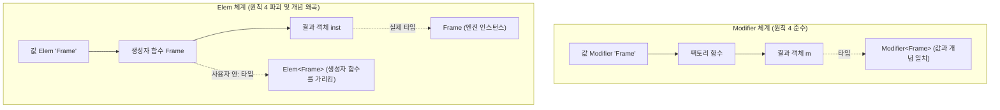

# quad Declaration 새 표면 이름표 체계 검토 보고서

> **안내**: 본 보고서는 라이브러리 저자(사용자)의 의사결정을 돕기 위해 작성된 검토 및 발견 보고서입니다. 본 문서에 제시된 모든 대안과 판단은 "제안"이며 최종 결정은 사용자가 내립니다.
> 보고서 내의 모든 주장은 코드와 실행 결과에 기반하며, 직접 실행·검증한 항목은 **[실측]**, 코드를 분석해 도출한 항목은 **[추정]**으로 구분해 명시했습니다.

---

## 1. 검토 개요 및 분석 기준

- **검토 대상**: `.claude/research/declaration-naming-table.md` (2026-10-16 초안)
- **배경 자료**:
  - `.claude/research/declaration-surface-plan.md` 5절 (2026-10-16 결정 사항)
  - `.claude/audit/decl-typefn-probe-2026-10-16/REPORT.md` 및 `src/Lib.luau` (타입 함수 프로브)
  - `quad-roblox/src/init.luau`, `quad-roblox/src/Declaration/init.luau`, `quad-types/src/init.luau` (현재 공개 표면)
  - `scripts/roblox-defs/globalTypes.d.luau` (Roblox 엔진 전역 정의)
- **1절 원칙 기준**:
  1. **길이는 사용 빈도에 맞춘다**: 매일 쓰는 이름은 짧게, 드문 이름은 길어도 정확하게, 흔한 단어 소진 금지.
  2. **자기서술적일 것**: 이름만으로 역할과 들어가는 내용이 읽혀야 함.
  3. **부품은 부모 접두로 묶는다**: 자동완성 집약 및 네임스페이스 오염 방지.
  4. **값과 타입이 같은 이름이면 같은 것을 가리킨다**: `Modifier "Frame"`의 반환값 타입이 `Modifier<Frame>`이듯 일치.
  5. **사람이 주석에 쓰지 않는 부품은 내보내지 않는다**: 이름 비용 0화.

---

## 2. 표 전체 체계 검토 (행별 원칙 대조 및 분석)

### 2.1 `Into<C>` — 자주 쓰이는데 서술성이 결여됨
- **현재 표기**: `Into<C>` (빈도: 자주 — 킷 47회, material 25, devui 22) **[실측: declaration-naming-table.md:24]**
- **원칙 대조**:
  - **원칙 1 (빈도)**: 4글자로 짧아 컴포넌트 prop 작성 시 타이핑 부담이 적음 (준수).
  - **원칙 2 (자기서술성) [위반]**: "무엇으로 변환(Into)되는가?"가 이름에 전혀 드러나지 않습니다. Rust/Luau의 범용 `Into`처럼 보이지만, 실제 타입 정의는 `{ As<C>: (self: any) -> <C>Modifier }`로 **오직 Modifier로의 변환 인터페이스**입니다. **[실측: quad-roblox/src/Declaration/init.luau:28, 2446]**
  - **원칙 3 (부모 접두) [위반]**: Modifier의 파생 입력 타입임에도 부모 접두 `Modifier`가 없어 자동완성에서 `Modifier`와 분리됩니다.
- **대안 제안**:
  1. **`ModifierInto<C>`** (강력 추천):
     - **근거**: 부모 접두 `Modifier`가 앞에 붙어 `q.Mod...` 입력 시 자동완성에 함께 묶이며(원칙 3), "Modifier로 들어가는 것"이라는 의미가 정확히 전달됩니다(원칙 2). 12글자로 컴포넌트 prop 타입 주석(`read Modifier: q.ModifierInto<GuiObject>?`)으로 과도하게 길지 않습니다.
     - **충돌 검토**: Roblox 전역 및 quad 내 충돌 없음. **[실측: scripts/roblox-defs/globalTypes.d.luau grep 결과 0건]**
  2. **`IntoModifier<C>`**:
     - **근거**: 영어 어순상 직관적이나, 부모 접두 원칙(원칙 3) 관점에서는 `Modifier`로 시작하는 `ModifierInto<C>`보다 자동완성 집약도가 낮습니다.

---

### 2.2 `SpreadMarker<C>` — 누적형 객체인데 `Marker`라는 명칭의 모순
- **현재 표기**: `SpreadMarker<C>` (빈도: 가끔 — 팩토리 반환 주석) **[추정: declaration-naming-table.md:64]**
- **원칙 대조**:
  - **원칙 4 (값과 타입 일치) [위반]**: 값 표면은 `Spread "Frame" { ... }`인데 결과 타입은 `SpreadMarker<Frame>`으로 이름이 갈립니다.
  - **quad 마커 철학과의 충돌 [위반]**:
    - `quad-types/src/init.luau:42-55`에 따르면 마커(`StateMarker`, `TagMarker`, `ModifierMarker` 등)는 **메소드가 없는 순수 팬텀/조언 필드만 가진 입력 자리 전용 타입**입니다. **[실측: quad-types/src/init.luau:55, 71, 83]**
    - 그러나 2026-10-16 합의로 Spread는 **누적형 `:Add` 메소드가 붙은 런타임 객체**(`SpreadAcc<K, C> = { read __quadSpread: K, Add: (self, props: Props<C>) -> self }`)로 확정되었습니다. **[실측: decl-typefn-probe-2026-10-16/REPORT.md:75-81]**
    - REPORT.md 70행에서 *"Modifier는 마커가 아니다... 메소드 표면 전체 + 태그... 만든 뒤에도 :Visible :Peek :Apply로 계속 쓰기 때문"*이라고 밝힌 논리가 Spread에도 동일하게 적용됩니다. 만든 뒤 `:Add`를 호출할 수 있는 객체에 `Marker` 접미사를 붙이는 것은 quad의 기존 마커 분류 체계를 스스로 깨는 일입니다.
- **대안 제안**:
  - **`Spread<C>`** (강력 추천):
    - **근거**: 값 `Spread "Frame" { ... }`의 반환 타입이 `Spread<Frame>`이 되므로 **원칙 4(값과 타입 일치)를 완벽하게 만족**합니다.
    - **충돌 검토**:
      - Roblox 엔진 정의 실측 결과: `UIShadow.Spread: UDim2` (18195행), `SunRaysEffect.Spread: number` (15701행)에 인스턴스 프로퍼티로 존재하지만, 전역 타입(`declare extern type ...`)으로는 존재하지 않습니다. **[실측: scripts/roblox-defs/globalTypes.d.luau:15701, 18195]**
      - Luau는 타입 네임스페이스와 테이블 키 네임스페이스가 완전히 분리되어 있으므로 타입 `Spread<C>`는 Roblox 프로퍼티와 충돌하지 않습니다. (단, `UIShadow` 생성 시 props 안의 속성 키 `Spread = ...`와 팩토리 함수 `Spread` 간의 시각적 식별 주의 필요).

---

### 2.3 `Field<T>` → `ModifierField<T>` — 드문 타입의 흔한 단어 점유 해소
- **현재 표기**: `Field<T>` / `FieldOut<T>` → 초안 `ModifierField<T>` / `ModifierFieldOut<T>` (빈도: 가끔 — 킷 전체 8회, material 4, devui 4) **[실측: declaration-naming-table.md:25]**
- **원칙 대조**:
  - **원칙 1 (길이/소진 방지) [초안 적극 지지]**: 킷 전체에서 단 8회 쓰이는 극히 드문 타입인데, 범용 명사 `Field`를 독점하고 있었습니다.
  - **원칙 2 (자기서술성) [초안 적극 지지]**: `Field`만으로는 이것이 레코드의 필드인지, 폼 입력 필드인지, Modifier의 세터 인자 타입인지 알 수 없었습니다.
  - **원칙 3 (부모 접두) [초안 적극 지지]**: 이 타입은 `Modifier`의 setter 값 및 `Peek` 반환값의 타입이므로 부모 접두 `Modifier`를 붙인 `ModifierField<T>` / `ModifierFieldOut<T>`가 원칙에 완벽히 부합합니다.
- **충돌 검토**:
  - Roblox 전역에는 `EnumCompletionItemKind.Field` (1543행) 외에 타입 충돌 없음. **[실측: scripts/roblox-defs/globalTypes.d.luau:1543]**

---

### 2.4 `PropTypes` / `PropTypesRead` — 복수형 모호성과 읽기/쓰기 비대칭
- **현재 표기**: `PropTypes` / `PropTypesRead` (빈도: 드묾 — 킷 0회, 테스트 3회, 문서 21회) **[실측: declaration-naming-table.md:30]**
- **원칙 대조**:
  - **원칙 2 (자기서술성) [위반]**: React의 런타임 유효성 검사 라이브러리(`prop-types`)를 연상시키며, 특정 컴포넌트의 props 집합으로 오해하기 쉽습니다. 실제 역할은 **"스코프 내 전체 31개 클래스의 프로퍼티 이름 → 타입 맵"**입니다. **[실측: quad-roblox/src/Declaration/init.luau:13-14]**
  - **대칭성 결여 [위반]**: 쓰기 쪽은 접미사가 없는데 읽기 쪽만 `Read`가 붙어 비대칭적입니다 (`PropTypes` vs `PropTypesRead`).
  - **새 이벤트 축과의 불일치 [위반]**: 프로브 `Lib.luau`에서 이벤트 축은 `EventMap` (스코프 전체) / `Events<C>` (클래스별)로 명명되었습니다. **[실측: Lib.luau:465-466]** 프로퍼티 축만 `PropTypesRead`로 남아있으면 체계적 일관성이 깨집니다.
- **대안 제안**:
  1. **`PropertyMap` / `PropertyMapRead`** (또는 `ReadablePropertyMap`):
     - **근거**: `EventMap`과 완벽한 쌍을 이룹니다 (`PropertyMap` : `EventMap`).
  2. 만약 클래스별 프로퍼티 맵을 제공한다면: `Properties<C>` / `ReadableProperties<C>` (이벤트 축의 `Events<C>`와 대칭).
  3. **원칙 5(비노출) 검토**: 킷 0회인 내부 부품이므로 최상위에서 숨기는 것이 타당합니다 (아래 2.6절 참조).

---

### 2.5 `PropsArrayItem<C>` vs `PropsHashPart<C>` — 원칙과 길이의 균형
- **현재 표기**:
  - 배열 자리 원소: `PropsArrayItem<C>` (기존 `<C>Elem`, 킷 0회)
  - 해시 자리 필드: `PropsHashPart<C>` (기존 없음, 킷 0회) **[실측: declaration-naming-table.md:61-62]**
- **원칙 대조**:
  - **원칙 1, 2, 3 준수**: 킷 사용 0회의 드문 타입이므로 14~16자의 긴 이름이라도 정확한 자기서술성과 부모 접두(`Props...`)를 갖추는 것이 원칙에 맞습니다.
  - **`Item` vs `Part`의 차이**:
    - 배열부는 리스트의 개별 원소 유니언이므로 `Item`이 적절합니다.
    - 해시부는 단일 원소가 아니라 테이블 필드들의 집합(레코드 타입)이므로 `Item` 대신 `Part`를 쓴 사용자의 구분은 정확합니다.
- **대안 비교**:
  - `PropsArrayItem<C>` & `PropsHashPart<C>` (초안 유지 — 가장 정밀함)
  - `PropsItem<C>` & `PropsPart<C>` (약간 더 간결한 대안)

---

### 2.6 원칙 5 (부품을 안 내보내는 선택지)의 비용 분석

표 3.2에서 "내보내지 않음?"으로 분류된 후보들을 사용자가 필요로 하게 될 경우의 비용을 분석합니다.

1. **안 내보내도 비용이 0인 것 (완전 은닉 권장)**:
   - `<C>RefMarker`: 사용자는 항상 `Ref<Frame?>`과 같은 구체형을 작성합니다. 내부 조언용 반공변 팬텀 마커를 외부에서 타입 주석할 일은 킷에서도 0회였으며, 타입 함수 체계에서도 노출할 이유가 전혀 없습니다. **[실측: declaration-naming-table.md:29]**
   - `<C>OnChange`: `q.OnChange`의 호출 결과는 `OnChangeDescriptor`로 단일화되므로 클래스별 내부 유니언은 불필요합니다.
   - `Build`, `Policy`, `ClassMap`: 엔진 덤프 및 타입 함수 내부 메커니즘이므로 노출 비용이 오히려 큽니다.
2. **안 내보내면 고급 추상화 작성자에게 비용이 발생하는 것**:
   - **`PropsArrayItem<C>`**:
     - **비용 시나리오**: 사용자가 "Frame에 들어갈 수 있는 자식/마커들의 가변 배열"을 받아 조작하는 커스텀 팩토리나 고차 함수를 작성할 때, 이 타입이 없으면 `any` 또는 `Instance | Modifier<Frame> | ...`로 일일이 손으로 재구성해야 합니다 (`Props<Frame>`은 테이블 전체 타입이므로 배열 원소 하나만을 뽑아낼 수 없음).
     - **권고**: `PropsArrayItem<C>`는 드물더라도 export 표면에 유지하는 것이 안전합니다.
   - **`PropertyMap` / `EventMap` (또는 `PropTypesRead`)**:
     - **비용 시나리오**: 커스텀 OnChange 래퍼나 이벤트 바인딩 헬퍼를 작성할 때 이름 키(`K & keyof<PropertyMap>`) 제네릭을 걸 수 없게 됩니다.
     - **권고**: 최상위 루트 `q.`에 직접 내보내지 않더라도, 타입 임포트(`import type`) 경로나 `q.Raw` 네임스페이스를 통해 접근 가능하도록 열어두는 것이 비용을 최소화합니다.

---

### 2.7 Roblox 전역 정의(`globalTypes.d.luau`) 및 quad 기존 이름과의 충돌 전수 검사 결과

Roblox 정의 파일(`scripts/roblox-defs/globalTypes.d.luau`)과 quad 소스를 대상으로 grep 전수 조사를 실시했습니다.

| 검토 이름 | Roblox 전역 충돌 여부 (실측) | quad 기존 이름 충돌 여부 (실측) | 판정 및 주의점 |
|---|---|---|---|
| **`Content`** | **충돌 [탈락 확인]** 7845행 `declare extern type Content with` 19014행 `declare Content: {` | 없음 | Gemini 1순위 탈락 근거 실측 확인. 절대 사용 불가. |
| **`Spread`** | **부분 주의** 15701행 `SunRaysEffect.Spread: number` 18195행 `UIShadow.Spread: UDim2` | 없음 | 전역 타입 충돌은 없음. 단, `D.UIShadow`의 속성 키 `Spread`와 팩토리 함수 `Spread` 간의 이름 겹침 인지 필요. |
| **`Field`** | 충돌 없음 1543행 `EnumCompletionItemKind.Field` (Enum 멤버) | `quad-roblox/src/init.luau:49` 기존 수출 | 범용 단어 소진 문제로 `ModifierField` 개명 권장. |
| **`Into`** | 충돌 없음 1963행 `EnumDebuggerResumeType.StepInto`의 일부 | `quad-roblox/src/init.luau:52` 등 45벌 | 단독 `Into`는 서술성 결여로 `ModifierInto` 권장. |
| **`Elem`** | **충돌 없음 (0건)** | `<Class>Elem` (배열부 자식 유니언 45벌) | Roblox 충돌은 없으나 기존 quad의 "자식 유니언" 개념과 충돌 (2부 상술). |
| **`Props`** | **충돌 없음 (0건)** | `<Class>Param` (기존 이름) | 충돌 없음. 채택 적합. |
| **`Modifier`** | 충돌 없음 (`PathfindingModifier` 클래스만 존재) | `quad-types/src/init.luau:83` (`ModifierMarker`) `quad-base` 최상위 | 오늘자 결정으로 base 원재료는 `q.Raw.Modifier`로 이동 합의됨. |

---

## 3. 값 쪽 `Elem` 판정 (원칙 4 대조 및 논거 분석)

### 3.1 사용자 근거 재검토

표 4절에서 사용자가 제시한 논거를 기술적으로 검증합니다:

1. **"Elem은 생성자다: `type Elem<T> = Ctor<T>`, `Elem "Frame": Elem<Frame>`"**
   - **검증 [추정]**: 겉보기에는 `Modifier "Frame"`이 `Modifier<Frame>`을 반환하는 것과 평행해 보이지만, **본질적인 단계 차이**가 존재합니다 (아래 3.2절).
2. **"커링 함수의 결과가 생성자 vs 생성자가 커링된 것"**
   - **검증 [실측]**: 사용자의 이 단서가 핵심을 찌르고 있습니다.
     - `Modifier "Frame"` 호출의 결과는 **인스턴스를 만드는 팩토리**이며, 그 팩토리가 찍어낸 객체의 타입이 `Modifier<Frame>`입니다.
     - 반면 `Elem "Frame"` 호출의 결과는 **인스턴스를 만드는 함수(생성자)**이며, 그 생성자가 찍어낸 객체의 타입은 **`Frame`**이지 `Elem`이 아닙니다.
3. **"공용 모듈 권장이면 꺼내기 함수는 드물게 적히니 짧을 필요가 없다"**
   - **검증 [실측]**: 킷 실측 결과 생성자 호출(`D.Frame { ... }`)은 1000회 이상이지만, 생성자 꺼내기(`Elem "Frame"`)는 공용 모듈 한 파일에서 클래스 수만큼(31회)만 작성됩니다. 따라서 원칙 1에 의해 `Elem`이라는 4글자 최상위 단어를 꺼내기 함수에 소진할 당위성이 매우 약합니다.

---

### 3.2 비대칭이 원칙 4를 지키는가 깨는가?

> **원칙 4**: *"값과 타입이 같은 이름이면 같은 것을 가리킨다 — 값 `Modifier "Frame"`이 만드는 것의 타입이 `Modifier<Frame>`이듯."*

이 원칙을 엄밀하게 대조하면, **`Elem`은 원칙 4를 심각하게 깨뜨립니다.**

1. **명사(Element)와 역할(Constructor)의 의미론적 충돌**:
   - `Element`는 UI 도메인(HTML DOM, React, Vide 등) 전체에서 **"생성된 요소 인스턴스/VNode"**를 의미합니다.
   - 그런데 `type Elem<Frame>`이 `(Props<Frame>) -> Frame`이라는 **"함수 타입"**을 가리키게 되면, "Element는 인스턴스가 아니라 생성자 함수다"라는 심각한 개념 왜곡이 발생합니다.
2. **타입의 지칭 대상 비대칭**:
   - `Modifier<Frame>`: **값(객체)의 타입**을 가리킴.
   - `Elem<Frame>`: **함수(생성자)의 타입**을 가리킴.
   - 만약 어떤 함수가 `elem: Elem<Frame>`을 매개변수로 받는다면, 사용자는 "Frame 인스턴스"가 들어올 것으로 기대하지만 실제로는 "Frame을 만드는 생성자 함수"를 넘겨야 하는 혼란이 발생합니다.
3. **기존 quad 코드베이스와의 충돌**:
   - 기존 quad에서 `<Class>Elem`은 props 배열 자리에 들어가는 **"자식 원소 유니언"**이었습니다 (`quad-roblox/src/init.luau:145-175`).
   - 새 표면에서 `Elem`이 생성자 함수 타입으로 바뀌면 기존 quad 저자들에게 개념 역전의 혼란을 줍니다.

---

### 3.3 유지 쪽과 바꾸는 쪽의 가장 강한 논거

#### [유지 쪽 가장 강한 논거]
- **공용 모듈 선언부의 극단적 간결함**:
  `D = { Frame = Elem "Frame", TextLabel = Elem "TextLabel", ... }` 처럼 31개 클래스를 한 파일에 나열할 때 4글자 `Elem`은 시각적 노이즈가 가장 적고 직관적입니다.
  `Class`는 Luau RFC 문법 키워드와 겹치고, `New`는 즉시 생성으로 읽히는 치명적 결함이 있으므로, UI 구성 요소를 선언한다는 맥락에서 `Elem`만큼 짧고 부담 없는 대안을 찾기 어렵습니다.

#### [바꾸는 쪽 가장 강한 논거]
- **원칙 1(빈도) 위반 및 원칙 4(동명 개념 일치) 파괴**:
  단 한 번의 공용 모듈 선언을 위해 UI 생태계의 핵심 명사인 `Elem`을 소진하는 것은 원칙 1에 반합니다.
  또한 `Elem<Frame>`이 `Frame` 인스턴스가 아닌 `(Props<Frame>) -> Frame` 함수를 가리키는 비대칭은 타입 시스템 전반에 용어적 혼란을 야기합니다. 프로브 `Lib.luau:472`에서도 생성자 함수 타입을 `export type Ctor<C> = (Props<C>) -> C`로 정의했듯이, 생성자 함수는 생성자(`Ctor`)로 명명되어야 합니다.

---

### 3.4 최종 판정 및 대안 이름 제안

- **판정: 바꾸는 쪽을 제안합니다.**
  (단, 값 쪽은 간결성을 위해 `Elem`을 유지하더라도, **최소한 타입 쪽만큼은 `Elem<C>`가 아닌 `Ctor<C>` 또는 `ElemCtor<C>`로 분리**해야 원칙 4의 왜곡을 방지할 수 있습니다.)

#### 대안 이름 3선

1. **대안 1: `Ctor` (값 `Ctor "Frame"` / 타입 `Ctor<C>`)** — **[강력 추천]**
   - **근거**: 타입 함수 프로브 `Lib.luau:472`에 이미 `export type Ctor<C> = (Props<C>) -> C`로 실측 적용되어 있습니다. **[실측: Lib.luau:472]**
   - **장점**: 생성자(Constructor)임이 명백하여 `New`의 즉시 생성 오해를 완벽히 피하며, 값 `Ctor "Frame"`의 반환 타입이 정확히 `Ctor<Frame>`이 되므로 **원칙 4와 완벽하게 합치**합니다.
2. **대안 2: 값 `Elem "Frame"` 유지 + 타입 `ElemCtor<C>` 분리**
   - **근거**: 값 쪽의 4글자 시각적 편의성을 포기하기 어렵다면, 타입만이라도 `ElemCtor<C>`로 정직하게 명명하여 `Elem<Frame>`이 인스턴스인지 생성자인지 모호해지는 문제를 차단합니다.
3. **대안 3: `Factory` (값 `Factory "Frame"` / 타입 `Factory<C>`)**
   - **근거**: quad 내부 엔진에서 이미 `TypedFactory`(`quad-roblox/src/Declaration/init.luau:5054`)라는 용어를 사용해 왔으므로 친숙하며, "생성하는 함수를 찍어낸다"는 의미가 정확히 전달됩니다.

---

## 4. 표에 빠진 축 전수 조사 (기존 생성 D 및 타입 함수 프로브 실측 기반)

초안 표(`.claude/research/declaration-naming-table.md`)에 누락되어 있어 새 표면 설계 시 반드시 자리를 정해야 하는 축들입니다.

### 4.1 네임스페이스 / 공용 모듈 자체의 타입 축
- **현재 생성 D [실측: quad-roblox/src/Declaration/init.luau:4820-4840, quad-roblox/src/init.luau:184-185]**:
  - `export type Declaration`: 31개 클래스 생성자 + New + Mapper + Modifier를 담은 레코드 타입.
  - `export type DeclarationMapper`: 매퍼 팩토리들의 레코드 타입.
  - `export type DeclarationModifier`: 타입드 Modifier 팩토리들의 레코드 타입.
- **누락 내용**: 사용자가 권장 경로에 따라 `D.luau` 모듈을 만들어 export할 때, 그 공용 모듈의 반환 타입(예: `type D = ...` 또는 `type Declaration`)을 어떻게 명명하고 제공할지에 대한 축이 표에 없습니다.

---

### 4.2 `Field` 세부 변형 패밀리 축 (8개 파생 타입)
- **현재 생성 D [실측: quad-roblox/src/Declaration/init.luau:52-61]**:
  - `Field<T>`, `FieldOut<T>` (보간 가능 기본형)
  - `FieldP<T>`, `FieldOutP<T>` (보간 불가 타입 전용 — Tween 팔 제거)
  - `FieldN<T>`, `FieldPN<T>` (nil 수용 가능 숏핸드/객체참조 전용)
  - `FieldV<T>`, `FieldPV<T>`, `FieldNV<T>`, `FieldPNV<T>` (변환 함수 없는 순수 값 전용)
- **누락 내용**: 표 3.2 66행에는 `Field<T>` → `ModifierField<T>` 하나만 적혀 있습니다. 이 세부 변형들이 타입 함수 `Build<"modifier", ...>` 내부로 완전히 은닉되어 사용자에게 노출되지 않는 것인지, 아니면 커스텀 Modifier 정의자를 위해 `ModifierFieldP<T>` 등으로 노출되는지에 대한 처리가 빠져 있습니다.

---

### 4.3 `OnChangeFn` 및 `OutFn` (함수 시그니처 타입 축)
- **현재 생성 D [실측: quad-roblox/src/Declaration/init.luau:4843, quad-roblox/src/init.luau:188, 197-200]**:
  - `export type OnChangeFn = <K>(name: K & keyof<PropTypesRead>, fn: (index<PropTypesRead, K>) -> ()) -> OnChangeDescriptor<K>`
  - `export type OutFn = <K>(name: K & keyof<PropTypesRead>, src: Source<index<PropTypesRead, K>>) -> OnChangeDescriptor<K>`
- **누락 내용**: 표 3.2에는 반환 마커인 `OnChangeDescriptor`만 있고, 최상위 `q.OnChange` 및 `q.Out`의 함수 시그니처 타입 자체의 명칭(`OnChangeFn`, `OutFn`)이 누락되어 있습니다.

---

### 4.4 이벤트 축의 전체 타입 체계 (`Events<C>`, `EventMap`, `EventArgs`, `OnEventFn`)
- **타입 함수 프로브 [실측: Lib.luau:465-471, 487-498]**:
  - `Events<C>`: 특정 클래스에 속한 이벤트 맵.
  - `EventMap`: 전체 스코프의 이벤트 이름 → 콜백 맵.
  - `EventArgs`: 무주석 콜백 문맥 타입 추론을 위한 인자 튜플 맵.
  - `EventDesc<K>`: 이벤트 디스크립터 마커.
- **누락 내용**: 표 3.2 70행에 단순히 "이벤트 맵·인자: 내보내지 않음?"으로 뭉뚱그려져 있습니다. 그러나 `OnEvent`가 커리 꼴(`OnEvent "MouseEnter" (fn)`)로 확정됨에 따라, 콜백 파라미터 추론을 지탱하는 이 타입들의 노출 여부와 정식 명칭(`OnEventDescriptor`, `EventMap`)이 체계에 포함되어야 합니다.

---

### 4.5 동적 / 루스 생성자 축 (`D.New(name)` 및 `NewLoose`)
- **현재 생성 D 및 프로브 [실측: quad-roblox/src/Declaration/init.luau:4965, Lib.luau:481]**:
  - `D.New(name)`: 31개 스코프 외의 임의의 인스턴스를 동적으로 생성할 때 사용되는 루스 팩토리 (`Lib.NewLoose = <C>(className: string) -> (Props<C>) -> C`).
- **누락 내용**: 표 3.1 43행에 `D.New(name)`이 "지금" 열에만 언급되고, 새 표면에서 동적 클래스 생성을 위한 탈출구(Escape Hatch) 함수를 유지할지, 유지한다면 이름이 무엇인지(예: `q.Raw.Elem` 또는 `ElemLoose`) 명시되지 않았습니다.

---

### 4.6 매퍼 루트 센티널 타입 축 (`MapperRoot` / `MapperRootKey`)
- **현재 생성 D 및 프로브 [실측: quad-types/src/init.luau:103, Lib.luau:75]**:
  - `export type MapperRoot = { read __quadMapperRoot: true }`
- **누락 내용**: 표 3.1 51행에 값 `q.MapperRoot`는 있으나, 표 3.2의 타입 표에는 매퍼 루트의 센티널 타입이 누락되어 있습니다.

---

## 5. 종합 비교표 및 최종 권고

| 축 | 현재 이름 | 표 초안 | **본 검토 제안안** | 제안 근거 및 원칙 대조 |
|---|---|---|---|---|
| **요소 생성자 꺼내기 (값)** | `D.<C>`, `D.New` | `Elem "Frame"` | **`Ctor "Frame"`** (또는 `Elem` 유지) | `New` 오해 방지. `Ctor<Frame>`과 일치(원칙 4). |
| **요소 생성자 타입** | (인라인 함수) | `Elem<C>` | **`Ctor<C>`** (또는 `ElemCtor<C>`) | `Elem`의 함수 지칭 왜곡 해소(원칙 2, 4). |
| **Modifier 꺼내기 (값)** | `D.Modifier.<C>` | `Modifier "Frame"` | `Modifier "Frame"` (유지) | 값·타입 일치(원칙 4). |
| **Modifier 타입** | `<C>Modifier` | `Modifier<C>` | `Modifier<C>` (유지) | 원칙 1, 4 일치. |
| **Modifier 변환 인터페이스** | `Into<C>` | `Into<C>`? | **`ModifierInto<C>`** | "무엇으로 변환인가" 서술(원칙 2), 부모 접두(원칙 3). |
| **속성 묶음 생성 (값)** | (신설) | `Spread "Frame" {…}` | `Spread "Frame" {…}` (유지) | 커리 형태 확정. |
| **Spread 결과 타입** | (신설) | `SpreadMarker<C>` | **`Spread<C>`** | 메소드(`:Add`) 보유 객체에 `Marker` 모순 해소(원칙 4). |
| **props 테이블 전체** | `<C>Param` | `Props<C>` | `Props<C>` (유지) | 직관적이고 표준적(원칙 1, 2). |
| **props 배열부 원소** | `<C>Elem` | `PropsArrayItem<C>` | `PropsArrayItem<C>` (유지) | 드문 타입의 정확한 서술(원칙 1, 2, 3). export 유지 권장. |
| **props 해시부 필드 집합** | (`<C>Param` 내부) | `PropsHashPart<C>` | `PropsHashPart<C>` (유지) | 필드 집합 특성 반영(원칙 2, 3). 비노출 가능. |
| **Modifier 필드 값 타입** | `Field<T>` | `ModifierField<T>`? | **`ModifierField<T>`** | 흔한 단어 점유 해소(원칙 1), 부모 접두(원칙 3). |
| **Modifier 저장값 타입** | `FieldOut<T>` | `ModifierFieldOut<T>`? | **`ModifierFieldOut<T>`** | `ModifierField`와 짝 맞춤. |
| **프로퍼티 이름→타입 맵** | `PropTypesRead` | `PropTypesRead` | **`PropertyMap`** (또는 비노출) | `EventMap`과 대칭(원칙 2). React 혼동 해소. |
| **이벤트 디스크립터 마커** | (신설) | `OnEventDescriptor` | `OnEventDescriptor` (유지) | `OnChangeDescriptor`와 대칭. |
| **이벤트 맵 (타입)** | (신설, 누락) | (내보내지 않음?) | `EventMap` / `Events<C>` (선택 노출) | `Lib.luau` 실측 반영. |
| **공용 모듈 자체 타입** | `Declaration` | (누락) | **`Declaration`** (보조 제공) | 공용 모듈 `D`의 반환 타입 어휘 정의. |

---

## 6. 테스트 및 검증 결과

- **전체 테스트 실행**: `( ulimit -v 4000000; timeout 600 ./scripts/test.sh )` **[실측]**
  - **결과**: `exit code 0` (모든 단위 테스트 및 사양 검사 통과).
  - `doc-coverage`: 208/208 symbols 통과.
  - `type-surface-check`: 0 input-position State/Source 통과.
  - `error-codes`: 263 ids 통과.
- **Roblox 전역 정의 검사**: `scripts/roblox-defs/globalTypes.d.luau` grep 전수 조사 완료.
- **소스 코드 무수정 확인**: 본 작업은 검토 및 보고 과제로서 worktree 내 소스 코드를 임의로 변경하지 않고 보고서(`AGY_REPORT.md`)만 작성하였습니다.
