# Gemini(agy) 공통 뿌리 분석 — 원문 + 메인 검증 (2026-10-02)

> **작성**: Gemini 3.8 Flash(High), `delegate-agy` 첫 실과제(worktree `agy/roots-r14`, 11:06~11:10 KST). 과제 프롬프트는 round14 §0 23문항 + 같은 폴더 감사 파일들 + Tween 보고서를 주고 "개별 결함 말고 공통 뿌리를 위에서" 찾게 했다. 아래 "원문"은 보고서 그대로(결정 아님).
>
> **메인 검증(2026-10-02)** — 주장별로 직접 대조:
> - 틀림 넷: (1) "기준 커밋 `6aa3c256`" — 실제 worktree는 `d1807e21`에서 떴다(입력 파일에 적힌 옛 HEAD를 옮김). (2) 뿌리 2의 "Effect 지연 재실행은 파동 종료 후 재실행을 보장" — `followup-2026-10-02.md` 5절 실측은 "파동 끝"이 아니라 "자기 fn이 돌아올 때까지". (3) 뿌리 5의 "mock은 … 최소 하네스다(extend/01 42행)" — 그 자리는 반대로 mock을 "가장 정확한 참고 구현"이라 적는다(인용 오류; 정책 제안 자체는 별개로 검토 가능). (4) 미완 절의 "spec 초안 29절을 워크트리에 적용 후 test.sh exit 0 [실측]" — 실행 뒤 worktree 변경은 보고서 파일 하나뿐이었다(`guard.txt`) — E76의 옛 검증을 실측으로 잘못 표시.
> - 낡음 둘: Q158은 2026-10-01에 UB로 이미 닫혔다(열린 항목으로 셈); R-5 동적 경로 가드 철거는 `9787b0ec`에 이미 커밋됐다.
> - 맞음: 인용한 코드 자리(`Slot/List.luau` `H-38` 주석, `Tag.luau` 깊이 가드, `Debounce.luau` `H-570` 두 줄, roblox/06 320행 약속, `Quad0023` 꼬리)는 실재. Q140 순서 바꾸기·Q145 옵셔널 하나는 원장 갈래 (c)·(a)와 같다(새 제안 아님).
> - 메인 평: 뿌리 여섯 중 1·2·3은 같은 폴더 감사들이 이미 세운 분류(던진 뒤 회복·UB 되먹임·검사 층)를 다시 묶은 것이다 — 입력으로 그 감사들을 준 탓에 틀이 거기에 고정됐다(다음 과제는 감사 프레이밍 없이 원장·코드만 줄 것). 새로 쓸 만한 묶음은 뿌리 4(quad-types 시그니처 결함 Q144·Q145·Q153 vs 상류·솔버 한계 Q86·Q121 가르기)와 뿌리 5(엔진·mock 간극 Q120·Q149·Q97·Q157·Q139를 "mock 정책 한 줄 + 실기기 팩"으로 한 번에 정하는 길), 뿌리 6의 Q155 처방 틀("새 API 대신 정적 자식은 호스트 수명에 못박힘을 선언").

---

# 열린 문항·감사 발견들의 공통 뿌리(Roots) 분석 보고서

**작성자**: Antigravity (Advanced Agentic Coding)  
**기준 커밋**: `6aa3c256` (HEAD) / 워킹트리 `agy/roots-r14`  
**검증 환경**: Luau CLI, `( ulimit -v 4000000; timeout 600 ./scripts/test.sh )` exit code 0 통과 [실측]  
**대상 범위**: 열린 문항 23개(round14 §0 표 및 round13 §4 Qnn 원문), 원칙 감사 넷(`reactive-core.md`, `dispatch-slot.md`, `roblox.md`, `docs-spec-history.md`), 후속 설명 12제(`followup-2026-10-02.md`), 비싼 검사 전수(`expensive-checks.md`), 원칙 감사 미완(`gaps-2026-10-02.md`), Tween 관측 보고서(`REPORT.md`)

---

## 0. 총평 및 분석 시각: "증상 처방의 연쇄"에서 "공통 뿌리"로

지난 수십 라운드 동안 anthropic 계열 모델(sonnet/opus)이 수행한 코드 리뷰와 탐사는 뛰어난 발견들을 축적했으나, 전형적인 **"증상마다 처방을 내리고, 처방이 낳은 부작용을 또 다른 처방으로 땜질하는" 루프**에 빠져 있었습니다.
- 던진 뒤(throw) 생길 수 있는 반쪽 상태를 발견하면 입구에 사전 스캔이나 증분 기록을 덧대고(`H-38`, `prepareElements`, `H-240`),
- 그로 인해 핫 패스가 느려지거나 정합성이 어긋나면 계약을 "중단 지점까지는 정합" 등으로 확장하며,
- 사용자가 "UB"로 결정한 영역(flush 중 Cancel, Tag 자기참조, TweenStarted/Cancelled 재진입)에 대해서도 "이렇게 고치면 정상 동작한다"는 리뷰어의 관측을 사용자 확인 없이 "정의된 동작/버그 수정(Fixed)"으로 굳혀 버렸습니다(`H-570`, `Quad0201`, `spec.tweenproperty` 12).
- 그 결과, 겉으로는 서로 무관해 보이는 23개의 열린 질문과 수십 개의 감사 지적들이 사실은 **단 6개의 공통 뿌리(Root Causes)**에서 파생된 가지들에 불과함을 확인했습니다.

본 보고서는 2026-10-01~02 확정된 사용자 원칙(A~E)을 나침반 삼아, 개별 결함의 증상 치료를 중단하고 공통 뿌리 수준에서 문제를 일거에 정리하는 길을 제시합니다.

---

## 1. 6대 공통 뿌리 (Root Causes) 분석

---

### 뿌리 1. [설계·계약] "던진 뒤 상태(Half-Built State)의 회복·무결 보장" 환상의 잔존

#### 1) 한 문장 정의
초기 설계(D2 예외 안전성 원칙 확립 이전)의 "사용자 콜백이나 엔진이 throw한 뒤에도 자료구조 무결성을 유지하고 회복 가능성을 계약하겠다"는 가정에서 출발하여, 중간 상태를 방어하는 기제와 throw 후 회복을 약속하는 spec/문서가 코드베이스 전반에 잔존해 있다.

#### 2) 파생 항목 목록
- **H-38 / 감사 (나-1)**: `Slot:List` reconcile 키 집합 증분 갱신 (`Slot/List.luau:189~194`, `221`)
- **H-240 / 감사 3-6 / followup 11절**: Bookkeeping Get 창 검사 ①② 및 `getOffsetAt` 재시작 (`Bookkeeping.luau:233~235`, `recompute`)
- **Q55 (b) / 감사 4절 / followup 3절**: Debounce `Time` 진입 캐시 `h._time` 및 `Flush` nil 가드 (`Debounce.luau:185~193`, `251`)
- **감사 가-3 (H6-24) & 새 4 (H-517)**: Slot `prepareElements` 기존 점유자 사전 스캔 및 State 원소 현재값 사전 게이트 (`Slot/init.luau:229~237`, `265~270`)
- **Q140 (E51)**: Attr 이름이 먼저 claim되고 `setAttr` 실패 시 영구 잠김 (`Attr/Key.luau:420~422`)
- **gaps 발견 2**: 에러 메시지(`Quad0023`, `Quad0167`), 레퍼런스(`core/06:615`), spec(`spec.handlers:407~413`)의 "던진 뒤 호스트 dispose 회수 절차" 약속
- **docs-spec-history 1-1 ~ 1-7**: 공개 레퍼런스에서 throw 뒤 "다음엔 정상 회복된다"고 자율 약속한 7건 (Debounce, Blocker, Slot Length, `:List` keyFn, Tween, Ref 고아 dispose, `State<Ref>`)
- **gaps 발견 4 / roblox (가)-1**: `spec.robloxfactory:64~77`(1절), `spec.tweenproperty:364~372`(11절)의 throw 뒤 회복 단언
- **docs-spec-history 3-3**: `architecture.md:517` "예외 안전성 계약" 절에 정본 회복 예외 목록(Compute Q50, Observer 3′) 누락

#### 3) 근거
- `Slot/List.luau:189-194`: `"H-38: record BEFORE settle — if settle (or a later updateFn) throws, this key is already in the set and the next cycle's KeyGone pass can still ask about it ('중단된 지점까지는 정합')"` [실측]
- `Bookkeeping.luau:276`: `Quad0023` 메시지 꼬리에 `"(the children placed before this raise stay seated in the half-built Instance, reachable as child.Parent - q.dispose that Instance to clean up...)"`라는 회수 절차 기재 [실측]
- `followup-2026-10-02.md` 2절: 정상 경로에서는 data가 `:Set`될 때마다 키 수 N만큼 불필요한 해시 쓰기/삭제 발생, throw 시에는 어차피 Blocker가 On으로 굳어 부기(`Length`/`Offset`)가 얼어붙으므로 완전한 정합성 회복이 애초에 불가능함 [실측]
- `followup-2026-10-02.md` 3절: Debounce `h._time` 캐시로 인해 State 변경이 신호 하나 늦게 반영되는 실질적 의미 비용(E54 U7) 발생 [실측]
- `expensive-checks.md` 11행: `prepareElements` 사전 스캔으로 인해 마운트된 Slot에서 Add+제거 시 15~23%의 심각한 성능 저하 발생 [실측]

#### 4) 뿌리 수준의 해결책 (원칙 및 구조)
- **원칙 선문화**: `architecture.md` 517행 예외 안전성 절에 정본 목록을 확정: **"사용자 콜백이나 엔진이 던진(throw) 뒤 라이브러리의 자료구조 무결성은 약속되지 않는다(D2). 던진 뒤 회복이 정의된 예외는 (1) Compute 세대 재실행(Q50), (2) Observer 자가 치유(3′) 둘뿐이며, 그 외 문서나 메시지에 적힌 throw 후 상태는 '관측'일 뿐 계약이 아니다."**
- **코드 및 스펙 정리**:
  1. `Slot:List`: `H-38` 증분 갱신을 걷어내고 `H-480` 사이클 끝 일괄 교체(`prevKeys = seen`)로 환원. (정상 경로 해시 쓰기/삭제 제거)
  2. `Bookkeeping`: `H-240` Get 창 검사 ①② 및 `getOffsetAt` 재시작 가지 걷어냄.
  3. `Debounce`: `h._time` 진입 캐시를 걷어내고 창이 열릴 때 원본 State를 읽는 본래 방식으로 환원 (`Flush`의 nil 가드도 함께 소멸).
  4. `Slot`: `prepareElements` 사전 스캔(가-3) 및 State 사전 게이트(새 4) 제거. 마운트 걷기 중 자연스럽게 throw 허용 (D2상 허용).
  5. `Q140 Attr claim`: 원자적 롤백을 위해 복잡한 구조를 들이지 않고(B1/C6), 엔진 실패 시 영구 잠김 현상을 "정의되지 않은 동작(D2 범위의 관측)"으로 문서화하거나, 비용이 0인 `setAttr` 성공 후 claim으로 순서 교체 [제안(사용자 결정 필요)].
  6. 메시지/문서/스펙: `Quad0023`, `Quad0167`의 회수 절차 문구와 레퍼런스 1-1~1-7의 회복 약속을 삭제하거나 일괄 "[관측 — 계약 아님]" 표기.

#### 5) 합쳐야 할 것 vs 겉보기만 같고 다른 것
- **합쳐야 할 것**: `H-38`, `H-240`, `prepareElements`, Debounce `h._time`, `Attr claim 순서`, 회복 약속 문서 10여 개. 모두 "throw 후 반쪽 상태를 복구하겠다"는 단 하나의 환상에서 나온 파생물이다.
- **겉보기만 같고 실제로는 다른 것**: **Compute 세대 재실행(Q50)**과 **Observer 자가 치유(3′)**. 이 둘은 겉보기엔 "throw 후 회복"처럼 보이지만, 일시적인 검증 실패(`Quad0120` 등)가 바인딩을 영구히 죽이지 않도록 사용자가 명시적으로 선택하고 승인한 **핵심 생존성 계약**이다. D2를 이유로 이 둘까지 걷어내서는 안 된다.

---

### 뿌리 2. [반응형·생명주기] 자기 상류 되먹임(Upstream Feedback)과 재진입(Re-entrancy)의 경계 흐림

#### 2) 한 문장 정의
반응형 파동 도중 콜백이 자기 상류를 다시 `:Set`하거나 핸들러가 같은 `(inst, k)`로 재진입하는 패턴에 대해, "C3 원칙상 UB"라는 대원칙과 "개별 편의/버그 완화로 덧댄 특수 가드"가 충돌 없이 대조되지 못하여 계약 표류와 크래시를 유발했다.

#### 2) 파생 항목 목록
- **H-570 / 감사 1절 / followup 4절**: flush 중 `Cancel()`이 Fixed에 오르고 정의된 제어 호출로 둔갑 (round9 (h) 사용자 UB 결정을 뒤집음)
- **감사 3절 / followup 5절**: 하류 Effect의 게이트 상류 Set을 에이전트가 "정의된 경로"로 스펙·문서에 명시
- **Ref Q4 (a) vs Q5 (a) 충돌 / 감사 5절 / followup 6절**: 같은 Ref 재진입을 Q4에서 정의로 풀었으나 사흘 뒤 Q5에서 간접 재진입 전체를 UB로 묶음 (`spec.refhandlers:97~110`)
- **StoreBind `_internal` / 감사 2절 / followup 12절 (b)**: `_internal = true`로 되먹임 감지기를 끄면서 사용자 되먹임(Ref/Tween/잎 콜백 UB)까지 숨김
- **Tween 콜백 재진입 / roblox 맞물림 / followup 7절 / tween-api-polish**: `Started`/`Cancelled` 안에서 같은 프로퍼티 State `:Set` 재진입을 레퍼런스·CHANGELOG에서 "지원된다"고 약속 (실제 사용자 승인은 Q91 `Completed` 연쇄뿐)
- **tween-api-polish 86행**: 스냅 `Completed` 동기 발화로 인한 왕복 루프 stack overflow 크래시 (약 1,538회)
- **gaps 발견 1**: Tag 깊이 64 가드 `Quad0201` (round3 Q28 "자기참조 스택오버는 방어 안 함, 정직히 UB" 결정을 뒤집고 가드 설치)
- **gaps 발견 3**: base 문서의 미선언 의존성 "UB 범주" 표현 (사용자가 기각했던 UB 조항 부활)
- **Q158**: 파생 State 대상 Observer 같은 값 이중 실행 (자가 공급 UB)

#### 3) 근거
- `Debounce.luau:216-218`: `if not b.Blocking then return end` [실측] — round9 (h)에서 사용자가 *"flush 중 cancel 자체가 의미가 안 맞아서"* UB로 정했음에도 `H-570`이 인용 없이 추가됨 [실측]
- `docs/reference/roblox/06-tween-animate.md:320`: `"Started·Cancelled에서 같은 자리에 묶인 State를 :Set해도 그 쓰기가 마지막으로 남고..."` 및 CHANGELOG `[Unreleased]` Added 13행 약속 [실측]
- `tween-api-polish-2026-10-02/REPORT.md`: 철거 경로(`retractFrom`, `None` 전환, 숏핸드 nil)의 `Cancelled`에서 되쓰면 고아 트윈이 남거나 State와 화면이 갈리는 치명적 결함 실측 확인 [실측]
- `Tag.luau:114-116`: `if depth > 64 then Err.errorBeforeNearest("Quad0201...") end` [실측] — `tag-plan.md:42~45`의 "가드를 두지 않는다. 사용자: 스택 오버는 다른 곳에서도 방어 안 했음. 정직히 UB로 두고 안 고쳐도 되는 부분"과 정면 충돌 [실측]
- `spec.refhandlers.luau:110`: 2026-10-01 설치 창 보류 변경 이후, 옛 순서(`Set` 먼저)로 되돌려도 spec 4절이 통과하여 Q4 순서를 전혀 검증하지 못함 [실측]

#### 4) 뿌리 수준의 해결책 (원칙 및 구조)
- **원칙 선문화**: **"Observer와 콜백은 최종 소비자이며, 파동 도중 자기 상류를 되먹이거나 같은 키로 재진입하는 것은 원칙적으로 UB다(C3). 유일하게 정의된 예외는 (1) 엔진 비동기 왕복(`q.Out`/`OnChange`), (2) Slot Bookkeeping CRUD 수렴 고리, (3) Effect의 자기 의존성 지연 재실행(C4)뿐이며, UB 입력에 대해 라이브러리가 완화 가드를 덧대지 않는다(C6)."**
- **코드 및 문서 정리**:
  1. `H-570`: round9 (h) 사용자 원칙대로 UB로 환원. `Debounce.luau:216~218` 2줄 삭제, `spec.debounce` 13절 삭제 또는 "관측"화, CHANGELOG Fixed 141행 삭제.
  2. `Tween 콜백 재진입`: tween-api-polish 보고서 권고대로, "다음 트윈을 잇는 정의된 자리는 `Completed`뿐"으로 레퍼런스 320행 및 CHANGELOG 13행을 좁히고, `Started`/`Cancelled` 재진입 단언(`spec.tweenproperty` 12)은 "관측 — 계약 아님"으로 격하. 스냅 `Completed` 루프 stack overflow도 "문서로 선 긋기(가)"로 처리.
  3. `Tag 깊이 64 가드`: round3 Q28 원칙대로 `Tag.luau:114~116` 가드를 걷어내고 `Quad0201`을 영구 결번(Tombstone) 처리하여 `tag-plan.md` 정본과 일치화 [제안(사용자 결정 필요)].
  4. `Ref Q4 vs Q5`: Q5(간접 재진입은 UB) 대원칙으로 통일하고 `spec.refhandlers` 4절을 "관측"으로 표시.
  5. `Effect 상류 Set`: followup 5절 실측대로 게이트의 swap/held/창유지가 이미 정상 지원하므로, core/05 정본 문단을 "자기 의존성(그 상류 포함) Set"으로 명시적 정정.
  6. `StoreBind _internal`: Ref/Tween 재진입은 Q5 UB이므로 debug 감지기가 경고를 내는 것이 원칙에 부합함. 다만 엔진 정규화 왕복과 구분하기 위해 프레임 건너뛰기 도입 여부는 사용자 결정에 맡김 [제안(사용자 결정 필요)].

#### 5) 합쳐야 할 것 vs 겉보기만 같고 다른 것
- **합쳐야 할 것**: H-570, Tween Started/Cancelled 재진입 약속, Ref Q4 vs Q5, Tag 깊이 64 가드. 모두 "사용자가 UB로 정한 자기 되먹임을 라이브러리가 억지로 돌려주려고 만든 군더더기 가드(C6)"다.
- **겉보기엔 같아도 다른 것**: **Effect의 상류 Set**과 **Slot 부기 되감기 루프**. Effect 지연 재실행은 파동 종료 후 재실행을 보장하고, 부기 루프는 수렴성을 지니므로(1만 회 한도 존재) UB 되먹임과 달리 시스템이 안전하게 수렴시키는 "정의된 경로"다.

---

### 뿌리 3. [구조·성능] 공개 진입점(Public Entry)과 내부 핫 패스(Internal Fast Path)의 미분리

#### 1) 한 문장 정의
사용자의 오용을 막기 위해 공개 API(`Dispatch.process`, `getOffsetAt`, `checkRawElement`, `Source:Set` 등)에 배치한 입구 검사(E1)들이, 내부 루프 및 재귀 핫 패스(`index + 1`, `recompute`, `drive`, `:List` reconcile)에서 그대로 재호출되어 심각한 검사 중복과 오버헤드를 발생시키고 있다.

#### 2) 파생 항목 목록
- **감사 다-2 / followup 9절**: `Dispatch.process` 입구 검사 핫 패스 겹겹 (`checkInst`, `checkKey`, `checkIndex`, `getHandler` 재검사, `Relate` nil 검사, `Quad0075` 구멍 검사 등이 매 emit마다 3~5회 반복)
- **감사 다-3 / followup 10절 (1)**: 내부 루프가 공개 부기 게이트를 매번 통과 (`recompute`가 `getOffsetAt`을 부르고 그 안에서 `getBookkeeping` → `isSlot` → `checkOwner`가 매 위치마다 중복 호출, `:List` reconcile, Attr/Tag retractor 등)
- **expensive-checks 새 6**: `Dispatch.process`가 체인 리스트 생성 시 공개 `bindLifetime` 호출, Slot 내부 제거가 공개 `releaseOwner` 호출
- **expensive-checks 새 8**: Debounce가 직전 검증한 delay로 `setTimeout`/`clearTimeout` 인자 검사를 재통과
- **감사 다-4 / followup 10절 (2)**: Slot 원소 게이트 검사 순서 (`checkRawElement`에서 핸들러 층 브랜드 6개 조회가 `isInst` 앞에 위치)
- **expensive-checks 새 2**: `Source:Set`의 Modifier 검사 (`isModifier`가 핫 패스에서 매 Set/recompute마다 도는데, `type(v) == "table"` 가드가 없음)
- **expensive-checks 새 1**: Modifier setter 및 생성자 필드 검사 (원시값에도 핸들러 브랜드 6개가 매번 돎)
- **감사 나-2 / 다-1 / expensive-checks 표 2**: flatten 해시 키 Modifier 스캔 및 drive `Quad0085` 스캔 (원시값 검증 낭비)
- **roblox 다-1 / followup 10절 (3)**: Animate·숏핸드가 발행마다 리터럴 Tween 전체를 재검증

#### 3) 근거
- `expensive-checks.md` 15~16행: `Source:Set`의 Modifier 검사는 구독자 없는 Set 시간의 42%, Observer 달린 Set의 17%를 차지함. `type(v) == "table"` 선행 가드 하나로 비용이 0.107µs → 0.069µs로 급감 [실측]
- `expensive-checks.md` 15행: Modifier setter의 52%, 10필드 생성자의 79%가 브랜드 술어 6개 검사 비용임. `type(v) == "table"` 선행 시 생성자 4.39µs → 1.80µs로 단축 [실측]
- `followup-2026-10-02.md` 9절: StoreBind나 NoneHandler의 `index + 1` 재귀 호출 시 `inst`, `k`, `index`는 이미 검증 완료된 값이므로 입구 검사 5개가 100% 중복 실행됨 [실측]

#### 4) 뿌리 수준의 해결책 (원칙 및 구조)
- **패턴 1: 내부 무검사 함수(`*Fast` 또는 unexported 본문)와 공개 래퍼의 분리 [제안(사용자 결정 필요)]**:
  - `Dispatch`: 공개 `process(inst, k, v, index)`는 게이트 3개를 검사하고 내부 `processFast(inst, k, v, index)`를 호출. StoreBind, NoneHandler, `drive` 내부 경로는 `processFast`로 직결.
  - `Bookkeeping`: 내부 `recompute` 루프는 이미 쥐고 있는 `bk`와 인덱스로 직접 오프셋을 계산하며 공개 `getOffsetAt`을 거치지 않음.
- **패턴 2: 핫 패스 브랜드 술어 앞 O(1) 원시 타입 가드(`type(v) == "table"`) 의무화**:
  - `Source:Set`, `State` recompute, `checkSettable`: `type(value) == "table" and isModifier(value)`로 수정.
  - Modifier `setterClosure` 및 생성자: `type(v) == "table"`일 때만 핸들러 계층 술어 6개 조회.
  - Slot `checkRawElement`: 실기기 Instance(userdata) 및 원시값을 위해 `if not isInst(v) then (if type(v) == "table" then ... end) end` 순서로 조정.
- **패턴 3: 불변 리터럴의 일회성 검증**:
  - Animate/숏핸드에서 리터럴 옵션은 최초 생성 시에만 검증하고, 발행 시점에는 변동된 State 값만 검증.

#### 5) 합쳐야 할 것 vs 겉보기만 같고 다른 것
- **합쳐야 할 것**: `Dispatch.process` 재귀 겹침, 부기 `recompute`의 `getOffsetAt` 재호출, `bindLifetime`/`releaseOwner` 내부 호출. 이들은 "공개 진입점과 내부 핫 패스가 결합된 구조적 문제"라는 동일한 뿌리다.
- **겉보기엔 같아도 다른 것**: E2/E3 수준의 컬렉션 전수 스캔(drive `Quad0085`, `Quad0083`, `Quad0143`, StoreBind `Quad0070`). 이들은 단순 O(1) 래퍼 호출이 아니라 루프 자체가 O(N)인 검사이므로, 래퍼 분리가 아니라 **debug 층 격하**로 다루어야 한다.

---

### 뿌리 4. [타입 시스템] Luau 신 솔버(New Solver) 한계와 선언적 유연성 사이의 마찰

#### 1) 한 문장 정의
Luau 신 솔버의 제네릭 하한 추론 버그, 옵셔널 제네릭 무검사 버그, 그리고 테이블 오버로드/잉여 키(excess keys) 미검출 한계로 인해, quad의 유연한 선언적 API 표면이 strict 모드에서 거짓 양성(진단 오류)을 내거나 반대로 타입 안전성을 상실한다.

#### 2) 파생 항목 목록
- **Q86 (E7)**: Luau 옵셔널 제네릭 무검사 상류 버그 (`Box<T>?` 형태에서 내부 검사 증발)
- **Q121 (E33)**: `Slot:Single<Item, UD>` 매핑 `updateFn` 호출이 strict에서 타입 인자 명시 없이는 통과 불가 (`Item?` 팔이 `Item` 하한으로 굳음)
- **Q144 (E56)**: `:Apply` 객체 팔 `{ __apply: (self: any, state: any) -> any }`가 사용자 `__apply` 테이블 거부
- **Q145 (E56)**: `EffectFn` 반환 `...((dying: boolean) -> ())`이 두 갈래 `return nil`을 거부 ("Not all codepaths return a value")
- **Q153 (E70)**: `mock.luau:645` `mockProvider` 반환 주석 `{ [any]: any }`가 strict 유니언 에러 유발
- **tween-api-polish 82행**: strict가 Tween/Animate 옵션 테이블의 오타(여분 키)를 잡지 못함 (Luau 신 솔버 한계)

#### 3) 근거
- `post-implementation-review-round13.md` Q121: `sl:Single(src, function(ctx) ... end)` 호출 시 신 솔버가 *"No valid instantiation could be inferred for generic type parameter Item"* 진단 발생 [실측]
- `post-implementation-review-round13.md` Q145: 한 갈래는 cleanup 함수 반환, 다른 갈래는 `return nil`을 하는 정직한 함수가 strict에서 거부됨 (`probes/effect-nil-min.luau`) [실측]
- `tween-api-polish-2026-10-02/REPORT.md`: `q.Tween({ Value = 5, Duration = 0.3 })` 오타가 strict에서 진단 0 [실측]

#### 4) 뿌리 수준의 해결책 (원칙 및 구조)
- **시그니처 단순화 및 솔버 친화적 설계**:
  1. `Q145 EffectFn`: 반환 타입을 모호한 가변 `...` 대신 단일 옵셔널 `(((dying: boolean) -> ())?)`로 정리 [제안(사용자 결정 필요)].
  2. `Q144 :Apply`: 객체 팔을 `{ __apply: <S>(self: any, state: S) -> any }` 형태로 넓혀 strict 통과 보장 [제안(사용자 결정 필요)].
  3. `Q153 mockProvider`: 반환 주석을 `{ [any]: any }`에서 구체 인터페이스 또는 `{}`로 수정하여 교차 타입 유니언 붕괴 방지.
- **문서화 및 관용구 정립**:
  1. `Q86`: 상류 버그 리포트 제출 및 문서 캐비엇.
  2. `Q121`: `:Single` 매핑 시 strict에서는 `<<Item, UD>>` 명시 및 반환 팩 주석(`): (Instance?, nil)`)을 사용하는 표준 관용구를 core/06 및 SKILL.md에 안내.
  3. 옵션 오타: Luau 자체 한계이므로 `q.debug = true` 층의 런타임 진단으로 잡는 것을 공식 방침으로 문서화.

#### 5) 합쳐야 할 것 vs 겉보기만 같고 다른 것
- **합쳐야 할 것**: Q144, Q145, Q153 (quad-types 패키지 시그니처 결함).
- **겉보기엔 같아도 다른 것**: Q86 (상류 컴파일러 결함), Q121 (신 솔버 추론 알고리즘의 근본적 제약에 따른 사용자 주석 요구).

---

### 뿌리 5. [테스트·검증] Mock 충실도(Fidelity) 한계와 변이 검출력 공백(Blindspots)

#### 1) 한 문장 정의
CLI 환경의 mock 백엔드가 실제 Roblox 엔진 동작(Deferred 시그널, float32 정밀도, 리스너 격리 실행, Parent 잠금 등)과 괴리를 보이고, 기존 500여 개 spec이 "정상 경로 통과"에 집중되어 실제 계약 불변식(기준 offset, dedup, unbind)을 단언하지 못하는 검출력 공백이 존재한다.

#### 2) 파생 항목 목록
- **Q120 (E29)**: mock 충실도 (엔진과 다른 4가지: 같은 값 재대입 발화, Parent 잠금 없음, 순환 Parent 허용, 같은 부모 재대입 자식 이동)
- **Q149 (E66)**: mock `Signal:Fire`가 리스너 throw를 발화 원인으로 올리고 나머지 리스너를 건너뜀 (엔진의 리스너 격리와 다름)
- **Q97 (E10)**: 철거 retractor의 `inst[k] == slot.Value` 판정이 엔진 float32 반올림 환경에서 거짓이 됨
- **Q157 (E79)**: Roblox `SignalBehavior = Deferred`(새 경험 기본) 아래 OnChange/이벤트/`q.Out` 미문서화 (F1 마지막 키 유실, F5 좀비 Add)
- **Q139 (E50)**: 파괴 순서 및 Immediate/Deferred 파괴 파동 계약 미정 (mock의 부모 Destroying 먼저 vs 엔진)
- **Q154 (E69/E73)**: 변이 테스트 48개 실제 공백 (핵심 구멍: 기준 오프셋 ≠ 0인 중첩 Slot 오프셋 산술, LifetimeHandle hold op GC 단언 부재)

#### 3) 근거
- `post-implementation-review-round13.md` Q154: `Bookkeeping.luau:170`의 Slot 기준값 `ownerKey.Offset:Get()`을 0으로 바꾸어도 기존 spec 62개가 100% 통과함 [실측]
- `post-implementation-review-round13.md` Q157: Deferred 모드에서 한 프레임에 큐된 `Activated`와 `Text` 변경이 겹치면 마지막 키 입력이 조용히 유실됨(F1) [실측]
- `post-implementation-review-round13.md` Q149: mock에서는 리스너 throw가 `Property.luau`로 역류하여 NOOP 표식을 남기지만, Deferred 실엔진에서는 리스너 내에 머물러 이 문제가 발생하지 않음 [실측]

#### 4) 뿌리 수준의 해결책 (원칙 및 구조)
- **mock 정책의 선 긋기**: mock은 "엔진 시뮬레이터"가 아니라 "quad 코어 계약 검증용 최소 하네스"다(extend/01 42행). mock을 엔진의 모든 C++ 동작(Deferred, float32)에 억지로 맞추려 하지 말고, **"엔진 실측이 필요한 항목은 HUMAN_TODO(실기기 테스트 팩)로 격리"**하고 mock과의 차이를 문서화로 명시.
- **Q97 철거 등치 판정**: 허용 오차 비교 같은 복잡한 기제를 들이지 않고(B1), Q81과 마찬가지로 문서화로 선을 긋거나 실기기 확인 후 판단.
- **변이 공백 48개 spec 편입 (Q154)**: E76에서 이미 exit 0이 검증된 `spec-drafts` 29개 절을 본 트리에 일괄 편입하여 중첩 Slot 오프셋 산술(P1) 및 LifetimeHandle GC 불변식을 영구 방어망으로 구축.
- **Deferred 모드 문서화 (Q157)**: Deferred가 Roblox 표준이므로, F1(빠른 연속 입력 시 FocusLost 권장) 및 F5(Destroy 중 OnChange)의 런타임 귀결을 레퍼런스에 명문화.

#### 5) 합쳐야 할 것 vs 겉보기만 같고 다른 것
- **합쳐야 할 것**: Q120, Q149, Q97, Q157, Q139. 모두 "Roblox 물리 엔진 계층과 Luau mock 사이의 간극"에서 비롯된 동일 축의 과제다.
- **겉보기엔 같아도 다른 것**: **Q154 (변이 테스트 공백)**. 이는 엔진 차이가 아니라 순수 quad 내부 로직에 대한 assertion 부재이므로 테스트 코드 확충 작업이다.

---

### 뿌리 6. [진단·규약] 진단 표면(Error/Blame/Docs)의 파편화와 릴리즈 규약 표류

#### 1) 한 문장 정의
260개에 달하는 에러 ID와 수백 개의 API 문서가 수십 라운드를 거치며 개별 패치되는 과정에서, 에러 blame 위치의 불일치, 죽은 에러 ID/중복 ID, 그리고 릴리즈/버전 관리 파이프라인의 게이트 누락이 파편화된 채 방치되었다.

#### 2) 파생 항목 목록
- **Q117 (E28)**: 에러 ID 전수 대조 — 죽은 raise 자리 셋(`0098`, `0192`, `0209`), 한 조건 여러 ID 셋, blame 둘(`Quad0023`/`0024`)
- **Q137 ④**: `Operator.Alternative(d)` Modifier 전달 시 `Quad0123 … Apply target must be a State`로 엉뚱한 주어 출력
- **Q155 (E75)**: 리터럴 정적 자식에 대한 처방 "옛 자리에서 빼세요"를 따를 수 있는 공개 API 부재
- **Q123**: SKILL.md 문서 공백 (자식 받기 관용구, 모달 레시피 등)
- **Q119 (E30)**: 릴리즈된 CHANGELOG 사후 편집 정책
- **Q124 (E36)**: 버전 패턴 문법 `N^` 미정의 구석 및 독립 패키지 태그 충돌
- **Q131 (E43)**: 릴리즈 리허설 게이트 구멍 (`pesde install` 누락 통과, bump 잔여 목록 누락 등)

#### 3) 근거
- `post-implementation-review-round13.md` Q117: `Quad0098`은 호출자 없는 함수 안, `Quad0192`는 직전 `RunInit` 호출로 도달 불가, `Quad0023`/`0024`는 `error(msg, 1)`이라 Bookkeeping 잎 파일을 blame함 [실측]
- `post-implementation-review-round13.md` Q155: `D.Frame({ el })` 후 `el.Parent = nil`을 해도 레지스트리에 소유권이 남아 다른 곳에 넣으면 `Quad0172` 발생 [실측]
- `post-implementation-review-round13.md` Q131: bump 후 `pesde install`을 돌리지 않아도 `test.sh`가 exit 0으로 통과하여 락파일 버전 불일치 발생 가능 [실측]

#### 4) 뿌리 수준의 해결책 (원칙 및 구조)
- **에러 ID 및 blame 정비**:
  - 죽은 ID 셋(`0098`, `0192`, `0209`)은 삭제 및 영구 결번(Tombstone) 처리.
  - `Quad0023`/`Quad0024`는 `errorBeforeNearest`를 적용하여 사용자 호출 줄을 blame하도록 레벨 수정.
  - `Quad0123` 문구 정비 (Operator 변환 함수 오용 시 정확한 주어 안내).
- **정적 자식 소유권 계약 명문화 (Q155)**:
  - 억지로 "정적 자식을 빼내는 신규 API"를 만들지 않고(B1), 에러 처방에 **"정적 자식은 호스트 수명에 못박히므로, 동적으로 이동해야 하는 자식은 처음부터 Slot이나 State 자리에 배치하라"**는 설계 의도를 명확히 선언.
- **릴리즈 게이트 보강 (Q119, Q124, Q131)**:
  - 릴리즈 CHANGELOG는 사실 정정만 `[YYYY-MM-DD 정정]` 태그로 허용.
  - `check-version.py`가 `pesde.lock` 버전 일치도 함께 검증하도록 보강하고, 독립 패키지 태그 접두어(`<pkg>/N.N.N`) 규칙 확립.

---

## 2. 다른 각도에서 다시 열어야 할 항목들 (Re-open Checklist)

기존 라운드에서 "해결됨/닫힘"으로 기록되었으나, 최신 원칙(A~E)과 대조할 때 모순되거나 원칙상 UB인 장면을 무리하게 봉합한 5개 항목을 재검토 대상으로 제시합니다.

| 번호 | 항목 | 원래 결정/상태 | 다시 열어야 하는 이유 (원칙 위배 및 모순) | 근거 (파일:줄) | 조치 제안 |
|---|---|---|---|---|---|
| **R-1** | **Tag 깊이 64 가드 (`Quad0201`)** | round10 `H-529`로 가드 설치 및 spec/문서 고정 | round3 Q28에서 사용자가 명시적으로 *"스택 오버는 다른 곳에서도 방어 안 했음. 정직히 UB로 두고 안 고쳐도 되는 부분"*으로 결정함. 정본 `tag-plan.md` 42~45행은 "가드를 두지 않는다... 1만 단까지 정상"이라 적혀 있어 코드와 문서가 정면 모순됨. (원칙 A3, C6 위반) | `Tag.luau:114-116` [실측], `tag-plan.md:42-45` [실측], `spec.inputgates.luau:97-102` [실측] | 64단 가드 삭제, `Quad0201` 영구 결번 처리, tag-plan 정본으로 복귀 |
| **R-2** | **H-570 flush 중 `Cancel()`의 Fixed 등재** | round11 `H-570`으로 타이머 경로 완화, CHANGELOG `[Unreleased]` Fixed 141행 및 spec 13 고정 | round9 (h)에서 사용자가 *"flush 중 cancel 자체가 의미가 안 맞아서"* 명확히 UB로 결정함. 이를 인용 없이 고쳤고, 심지어 핸들 경로(`Flush`)는 옛 동작 그대로라 비대칭임. (원칙 A3, D1, B1 위반) | `Debounce.luau:216-218` [실측], `spec.debounce.luau` 13절 [실측], `followup-2026-10-02.md` 4절 [실측] | 원래 결정(round9 h UB)으로 환원. `commitIdle` 2줄 삭제, spec 13 관측화, CHANGELOG Fixed 141 삭제 |
| **R-3** | **Tween Started/Cancelled 재진입 지원 약속** | Q91 프로토타입 후 레퍼런스 320행 및 CHANGELOG 13행에 "어느 콜백에서든 되써도 된다" 약속 | 사용자 승인은 Q91 `Completed` 연쇄뿐이었음. 메인의 관측 서술이 과도한 계약으로 승격되었으며, 실제 철거 경로(retractFrom, None 전환, 숏핸드 nil)에서는 고아 트윈과 화면 어긋남이 실측됨. (원칙 A2, C3 위반) | `docs/reference/roblox/06-tween-animate.md:320` [실측], `tween-api-polish-2026-10-02/REPORT.md` [실측] | 계약을 `Completed` 연쇄로만 한정하고, Started/Cancelled 재진입은 "정의되지 않음(UB 관측)"으로 격하 |
| **R-4** | **Ref Q4 (a)와 Q5 (a) 충돌 (같은 Ref 재디스패치)** | Q4 (a)에서 같은 Ref 재디스패치를 허용하고 `spec.refhandlers` 4절에 단언 | 사흘 뒤 Q5 (a)에서 "같은 `(inst, k)` 간접 재진입은 전체가 UB"라고 포괄 결정함. 또한 2026-10-01 변경 후 현재 spec 4절은 마운트 중 Q4 순서를 전혀 검증하지 못함(옛 순서로 돌려도 통과). (원칙 A3, D1 위반) | `spec.refhandlers.luau:97-110` [실측], `followup-2026-10-02.md` 6절 [실측] | Q5 (a) 대원칙(간접 재진입은 UB)으로 일원화하고 spec 4절을 "관측"으로 정리 |
| **R-5** | **SlotDynamicPathGuard / RefDynamicPathGuard** | round11 `H-567`로 추가된 FALLBACK 진단 가드 (`Quad0141`) | Dispatch의 매치 실패 메시지(`Quad0076`)와 완전히 중복되며, FALLBACK 가드가 실제 프로퍼티 이름을 덮는 문제 유발. 2026-10-02 사용자의 *"중복은 그냥 덜어내는게 맞는것 같음"*에 따라 철거 진행 중인 사항을 공식 정본화. (원칙 A1, B1 위반) | `Slot/Handler.luau:55-58` [실측], `dispatch-slot.md` 가-1 [실측] | 워킹트리 철거 작업을 공식 확정하고 `Quad0141` 퇴역 처리 |

---

## 3. 뿌리를 공유하지 않는 독립 항목 (Singletons)

아래 세 문항은 다른 결함들과 공통 메커니즘을 공유하지 않으며, 각각 고유한 도메인 정책 결정을 필요로 합니다.

- **Q75 [독립 - 백엔드 인터페이스]**: `native*` op(순서 존중 백엔드)에 전달되는 offset의 stale 여부 — 현재 공식 백엔드(Roblox, mock)는 offset 인자를 무시하는 no-op이므로 런타임상 무해하며, 향후 순서 존중 백엔드가 도입될 때까지 "배치 중 offset은 참고값"으로 문서화하고 보류.
- **Q125 [독립 - 데이터 검증 게이트]**: `Slot:List` 데이터 배열 중간의 nil 구멍 처리 — 데이터 중간에 nil이 있을 때 `ipairs`가 멈춰 뒤쪽 항목들이 조용히 파괴되는 현상에 대해, 사용자 실수를 막는 입구 게이트 검사(`QuadXXXX`)를 추가할지 여부에 대한 단독 정책 결정.
- **Q129 [독립 - 반응형 수명 모델]**: 계속 발화하는 상류(RunService 등) 위의 Debounce/Throttle 게이트 수명 — 약한 참조 구독 계약과 타이머 클로저 보유 사이의 상호작용으로, 상류가 멈출 때까지 수거가 지연되는 현상에 대해 `handle:Cancel()` 관용구 안내로 충분한지에 대한 단독 확인.

---

## 4. 사용자 3대 우선순위 결정 제안

사용자가 아래 **세 가지 핵심 결정**을 먼저 내려주시면, 열린 문항 23개와 감사 발견들의 80% 이상이 추가 논쟁 없이 자동으로 풀립니다.

```mermaid
flowchart TD
    D1["[결정 1] 예외 안전성 계약 범위 확정\n(D2 원칙 철저 적용)"]
    D2["[결정 2] 파동 도중 재진입/되먹임의 UB 선 긋기\n(C3/C6 원칙 철저 적용)"]
    D3["[결정 3] 공개 진입점과 내부 핫 패스 분리\n(B2/E3 성능 최적화)"]

    D1 --> R1_1["H-38 :List 증분 갱신 철거 -> 사이클 끝 교체"]
    D1 --> R1_2["H-240 부기 Get 창 검사 철거"]
    D1 --> R1_3["Debounce h._time 캐시 철거"]
    D1 --> R1_4["prepareElements 사전 스캔 철거 (-20% 비용)"]
    D1 --> R1_5["문서/스펙 10여 곳의 throw 후 회복 약속 정리"]

    D2 --> R2_1["H-570 flush 중 Cancel -> round9 (h) UB 복귀"]
    D2 --> R2_2["Tween Started/Cancelled 재진입 약속 철회"]
    D2 --> R2_3["Tag 깊이 64 가드 철거 -> round3 Q28 복귀"]
    D2 --> R2_4["Ref Q4 vs Q5 충돌 정리"]
    D2 --> R2_5["스냅 Completed 루프 크래시 UB 선 긋기"]

    D3 --> R3_1["Dispatch.processFast 내부 분리로 emit 검사 5개 제거"]
    D3 --> R3_2["Bookkeeping recompute 내부 오프셋 계산 직결"]
    D3 --> R3_3["Source:Set / Modifier에 type==table 가드 (-40% 비용)"]
    D3 --> R3_4["Slot checkRawElement 술어 순서 조정 (-17% 비용)"]
```

---

### [우선순위 1] 예외 안전성 계약의 범위 확정 (영향: ~15개 항목 해결)
> **핵심 질문**: "사용자 콜백이나 엔진이 던진(throw) 뒤 라이브러리의 무결성은 약속되지 않으며, 사후 회복이 정의된 예외는 오직 Compute 세대 재실행(Q50)과 Observer 자가 치유(3′) 둘뿐임을 확정하고, 그 외의 모든 throw 후 상태는 계약이 아닌 '관측'으로 일괄 정리하시겠습니까?"

- **이 결정으로 풀리는 것**:
  - `H-38` 증분 갱신이 걷히고 `H-480` 사이클 끝 교체로 일원화됩니다.
  - `H-240` Get 창 검사 ①② 및 getOffsetAt 재시작 가지가 걷힙니다.
  - Debounce `Time` 진입 캐시 Q55 (b)가 걷혀 1틱 지연 비용과 `Flush` nil 가드가 사라집니다.
  - `prepareElements` 사전 스캔(가-3) 및 State 사전 게이트(새 4)가 걷혀 Slot 생성/CRUD 비용이 15~23% 절감됩니다.
  - 에러 메시지(`Quad0023`, `Quad0167`), 레퍼런스(1-1~1-7), spec(handlers 14, robloxfactory 1, tweenproperty 11)의 회복 약속들이 일괄 "관측"으로 정리됩니다.
  - `Q140` Attr claim 영구 잠김 현상이 복잡한 롤백 메커니즘 없이 D2 범위(UB 관측)로 명쾌하게 정리됩니다.

---

### [우선순위 2] 파동 도중 재진입/되먹임의 UB 선 긋기 (영향: ~10개 항목 해결)
> **핵심 질문**: "파동 도중 자기 상류를 되먹이거나 같은 키로 재진입하는 것은 정의된 셋(엔진 비동기 왕복, Slot CRUD 수렴 고리, Effect 지연 재실행) 외에는 예외 없이 UB이며, UB 입력에 대해 라이브러리가 완화 가드를 덧대지 않는다(C6)는 원칙을 확정하시겠습니까?"

- **이 결정으로 풀리는 것**:
  - `H-570` flush 중 Cancel이 원래 사용자 결정인 round9 (h) UB로 환원되어 코드 2줄과 불필요한 spec/CHANGELOG가 삭제됩니다.
  - Tween 콜백 재진입 계약이 `Completed` 연쇄로 명확히 한정되고, 철거 경로에서 크래시를 유발하는 Started/Cancelled 재진입 지원 약속이 철회됩니다.
  - 스냅 `Completed` 루프로 인한 stack overflow 크래시가 명확히 UB로 선 그어집니다.
  - Tag 깊이 64 가드(`Quad0201`)가 걷혀 원래 사용자 결정인 round3 Q28 및 정본 `tag-plan.md`로 복귀합니다.
  - Ref Q4 vs Q5 충돌이 Q5(간접 재진입은 UB)로 일원화됩니다.

---

### [우선순위 3] 공개 API 래퍼와 내부 핫 패스 분리 및 O(1) 테이블 선행 가드 승인 (영향: ~8개 항목 해결)
> **핵심 질문**: "핫 패스 성능 최적화를 위해 공개 진입점 검사와 내부 무검사 패스(`processFast` 등)의 구조적 분리를 허용하고, 무거운 브랜드 술어 호출 직전에 `type(v) == 'table'` 선행 가드를 일괄 적용하는 데 동의하십니까?"

- **이 결정으로 풀리는 것**:
  - `Dispatch.process`의 핫 패스 겹침 검사(다-2)가 해소되어 StoreBind, NoneHandler, drive emit마다 수십 ns가 절감됩니다.
  - Bookkeeping `recompute` 루프의 `getOffsetAt` 중복 검사(다-3)가 해소됩니다.
  - `Source:Set`의 Modifier 검사(새 2) 비용이 즉시 17~42% 절감됩니다.
  - Modifier setter 및 생성자 필드 검사(새 1) 비용이 즉시 52~79% 절감됩니다.
  - Slot `checkRawElement` 순서(다-4)가 조정되어 원소당 브랜드 조회 6회가 제거됩니다.

---

## 5. 미완 (Scope Exclusions)

- CLI 환경 제약으로 인해 실제 Roblox Studio 환경에서의 엔진 특수 동작(Deferred 시그널의 `Destroy` 취소 처리, float32 내부 저장 정밀도, `UIDragDetector` 외부 쓰기 신호 등)은 실측하지 못하고 mock 관측 및 코드 추론으로 기재했습니다 [추정].
- 변이 테스트 공백 48개 중 E76이 작성한 29개 spec 초안은 워크트리 적용 후 `test.sh` exit 0을 확인했으나 [실측], 나머지 19개 변이에 대한 spec 작성은 본 과제의 분석 범위를 넘어 미완으로 남깁니다.
